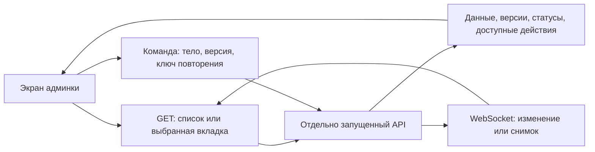

# Карта API админки League Sim Racing

Дата: 11 октября 2026. Базовый коммит исходников: `a18497c`.

Документ описывает **админку, опубликованную в этом репозитории**: исходники из `admin-source-20261009-215621.zip`. Это не Stage15. Маршруты и основные ограничения сверены с backend из `shared-frontend-backend-source-20261010-224621.zip`. Исходники backend и публичного сайта в репозиторий не добавляются.

Это карта потребления API для разработки интерфейса, не новый контракт и не результат проверки работающего сервера. TypeScript-типы показывают ожидания клиента; они сами по себе не проверяют JSON во время выполнения. Поля `unknown`, `Record<string, unknown>` и `string` действительно есть в коде: там контракт клиента неполный, а не подразумевается фиксированный набор значений.

## Содержание

1. [Общая схема](#общая-схема)
2. [Правила запросов](#правила-запросов)
3. [Вход и права](#вход-и-права)
4. [События: список и редактор](#события-список-и-редактор)
5. [События: просмотр и проведение](#события-просмотр-и-проведение)
6. [Статусы, время и результаты](#статусы-время-и-результаты)
7. [Остальные разделы](#остальные-разделы)
8. [Обновления в реальном времени](#обновления-в-реальном-времени)
9. [Как подключать новый макет](#как-подключать-новый-макет)
10. [Ограничения текущего клиента](#ограничения-текущего-клиента)
11. [Техническое приложение: вызовы и модели](#техническое-приложение-вызовы-и-модели)

## Общая схема



| Что нужно интерфейсу | Где брать |
| --- | --- |
| Список объектов | Отдельный list-запрос с фильтром и пагинацией |
| Шапка события, текущий этап, счётчики и кнопки | `GET /admin/events/{eventId}/workspace` |
| Трасса, погода, игровые параметры этапа | `GET /admin/events/{eventId}/workspace/conditions?stageKey=…` |
| План и факт проведения | `workspace/schedule`, а также `runtime` и `runtime-history` |
| Настройки для редактирования | `workspace/edit`; для формы создания — каталог сценариев и `resolve` |
| Можно ли выполнить действие | `actions`, `allowedActions`, права и ограничения редактирования; затем серверная проверка команды |
| Понять, что данные изменились | Канал `admin:changes`; перечитать нужный GET |
| Текущее состояние демона | GET-снимок + канал `admin:runtime` |

## Правила запросов

Основной транспорт: [admin/src/shared/api.ts](admin/src/shared/api.ts).

- Базовый адрес — `VITE_API_BASE_URL`, по умолчанию `http://localhost:3000`. Пути ниже относительно API, не URL страниц админки.
- `apiFetch<T>(path, init?, tokenMode?)`: GET по умолчанию; `tokenMode` = `admin` по умолчанию, также `user` и `none`.
- Авторизация: `Authorization: Bearer …`, запросы с `credentials: include`. Cookie используются для восстановления сессии; токены хранятся в памяти клиента.
- JSON-тело сопровождается `Content-Type: application/json`; для `FormData` заголовок задаёт браузер. Ответ 204 означает отсутствие тела.
- Для команд используется `Idempotency-Key`. В API событий и standalone-командах его задаёт вызывающий код. Для изменений каталога, публикаций, загрузок и скинов часть ключей добавляет общий транспорт. Не все POST одинаковы: `resolve`, например, — вычисление формы без сохранения.
- При повторении неподтверждённой команды сохраняются её ключ и тело. Это отличается от нового действия пользователя.
- Версия нужна для защиты от перезаписи: события/черновики/контент часто используют `expectedVersion`; matchmaking — `version`; практика — `version` при сохранении конфига; профиль, grants и организаторы — `If-Match`. Нельзя заменять всё одним полем без адаптера.
- При 401 транспорт пытается обновить сессию и повторить запрос при сохранении той же сессии. 403 — отказ в доступе или бизнес-допуске; он не означает пустой список.
- Ошибки обычно имеют `error.code`; клиент преобразует известные коды в сообщения. Есть специальные тела, например `decision.allowed=false` при отказе рассмотрения заявки. Не предполагать единый текстовый формат всех ошибок.
- Ответы справочников машин, брендов и DLC могут кратко кешироваться клиентом (до 60 секунд). Рабочая история и персональные данные этим кешем не покрываются.

### Форматы списков

| Формат | Что отправлять дальше | Где используется |
| --- | --- | --- |
| `{items, nextAfterId}` | `afterId=nextAfterId` | События, черновики, большинство вкладок workspace, протесты, решения, публикации, каталог |
| `{items, nextCursor}` | Зависит от экрана; курсор не всегда называется `cursor` в запросе | Аудит, журналы, чаты |
| `{items, hasMore, nextBeforeId}` | `beforeId=nextBeforeId` | Старые сообщения чата |
| `{items, total}` | `page`, `pageSize` | Практика, история матчей |
| `{items, pagination}` | `page`, `pageSize` | Пользователи; `pagination.total/totalPages` |
| `{items, nextAfterSequence}` | `afterSequence` | История рейтинга пилота |
| Массив `T[]` | Обычно без пагинации | Организаторы, игровые справочники; некоторые истории |

Не подменять отсутствие данных нулём. `null` означает отсутствие/неизвестность значения в конкретном контракте, `[]` — пустой полученный список, отсутствие поля (`?` в типе) — допустимую неполную проекцию.

## Вход и права

| Запрос | Передаём | Получаем / зачем |
| --- | --- | --- |
| Переход на `GET /admin/auth/steam` | Redirect из `LoginPage` | Внешняя авторизация, затем callback с кодом |
| `POST /auth/exchange` | `{code}` | `{accessToken}` пользовательской сессии |
| `POST /auth/refresh`, `/admin/auth/refresh` | `{}` + cookie | `{accessToken}` для соответствующей сессии |
| `GET /users/me` | User Bearer | `steamId`, `steamName`, `steamAvatar` на экране входа |
| `POST /admin/auth/login` | User Bearer + `{adminPassword}` | Административный `accessToken` |
| `GET /admin/me/access` | Admin Bearer | `AdminAccess`: доступные области и grants/permissions |
| `POST /admin/auth/logout` | `{}` + cookie | Завершение административной сессии |

Синхронизация refresh/logout между вкладками реализована в `shared/browser-session-lock.ts`; это транспортная часть, не данные для карточек.

Права имеют области `platform`, `organizer`, `event`. Формы должны сохранять серверные ограничения: разрешённые типы событий, лимиты организатора, сроки действия grants. Скрытая кнопка не заменяет проверку API.

## События: список и редактор

### Список

| Запрос | Фильтры текущего экрана | Результат |
| --- | --- | --- |
| `GET /admin/events` | `view=list`, `limit=20`, `q`, `publication`, `afterId` | `{items: EventSummary[], nextAfterId}` |
| `GET /admin/event-drafts` | `q`, `afterId` | `{items: Draft[], nextAfterId}`; загружается при праве создания, кроме фильтра только опубликованных |

Backend дополнительно принимает у списка событий `status`, `organizerId`, `scenarioCode`. Наличие серверного фильтра не означает, что он уже выведен в текущем интерфейсе.

`EventSummary`: `id`, `title`, `description`, `scenarioCode`, возможный `scenarioTitle`, `organizerId`, `gameCode`, `disciplineCode`, `timezone`, `startsAt`, `endsAt`, `status`, `displayStatus`, `displaySchedule`, `observedAt`, `version`, `presentation`, `actions`.

`presentation`: обложка `coverUrl`, подзаголовок `subtitle`, параметры карточки `cardAppearance`. Это не полный контент игровых условий.

### Создание, черновики, изменение

| Метод и путь | Тело / параметры | Ответ и назначение |
| --- | --- | --- |
| `GET /admin/event-authoring/catalog` | Необязательный `organizerId` | `Catalog`: игры и описатели сценариев |
| `POST /admin/event-authoring/resolve` | `{document, revision, edit?}` | `Resolution`: проверка, ограничения, предпросмотр расписания, `canPublish` |
| `POST /admin/event-drafts` | `{document}` | Новый `Draft` |
| `GET /admin/event-drafts/{id}` | — | Сохранённый `Draft` |
| `PUT /admin/event-drafts/{id}` | `{document, expectedVersion: draft.revision}` | Обновлённый `Draft` |
| `DELETE /admin/event-drafts/{id}` | `{expectedVersion: draft.revision}` | Удаление черновика |
| `POST /admin/event-drafts/{id}/publish` | `{expectedVersion: draft.revision}` | `{eventId}` |
| `GET /admin/events/{id}/copy-template` | — | `{scenarioCode, settings}` для копии |
| `GET /admin/events/{id}/workspace/edit` | — | `settings`, `description`, `version` для редактора |
| `PUT /admin/event-authoring/events/{id}` | `{expectedVersion, document}` | Сохранение формы опубликованного события; клиент затем перечитывает данные |
| `PATCH /admin/events/{id}` | `{expectedVersion, patch}` | Совместимая правка; текущая оболочка использует для описания |

`Document = {contractVersion: 1, scenarioCode: string|null, settings, pendingImages: string[]}`.

`Draft = {id, document, revision: string, publishedEventId: string|null, updatedAt}`. Не путать `Draft.revision` с числовой `Resolution.revision`, которая обозначает ревизию проверки формы.

**Варианты формы приходят с сервера**, а не только из макета. `Descriptor` содержит `enabled/reason`, `defaults`, `sections`, `components`, `constraints`, `admissionTypes`, `entryTypes`, `carChangePolicies`, `licenses`, `raceDefaults`, `practiceDefaults`, `raceOverrideFields` и `options` (assists, registration, raceFormats, raceAggregation, elimination, pairing, scoring, rating).

`Resolution` содержит:

- `issues[]`: `code`, `path`, `sectionId`, `message`, `severity` (`error` или `warning`);
- `canPublish`, возможные `warnings`;
- `editRestrictions`: `structureLocked`, `scheduleLocked`, `paths`;
- `preview`: период события, `displaySchedule`, блоки с `requiredServers` и плановыми датами, окна регистрации;
- `preview=null`, когда подходящий предпросмотр не сформирован.

Для трасс, машин, наборов, плагинов и погоды редактор отдельно читает `/games/assetto_corsa/{cars|tracks|car-sets|catalog/plugin|weather-presets}`. Это справочники выбора, а не сохранённые условия проведённой гонки.

## События: просмотр и проведение

Сначала `GET /admin/events/{eventId}/workspace`. Затем отдельные запросы по открываемой вкладке. Базовая сводка **не является полной моделью события со всеми вложенными данными**.

`WorkspaceSummary` содержит:

- `eventId`, `version`, `observedAt`, `event: EventSummary`;
- `actions`, `editableFields`;
- `metadata`: даты создания/изменения/публикации, автор и организатор, каждый допускает отсутствие согласно типу;
- `currentStage`, `nextStage`, `stop` — могут быть `null`;
- `program?`: `key`, `title`, `type`, `startsAt`, `endsAt`, `track`, `cars`;
- `counts`: этапы, результаты, возможный счётчик участников;
- `activity`: pending/accepted заявок, active/uncertain runtime, наличие регистрации;
- `primaryResultId` — может быть `null`.

### Подробные проекции

Во всех строках ниже префикс — `/admin/events/{eventId}/workspace/`. GET. Для постраничных вкладок backend поддерживает `limit` (по умолчанию 25, максимум 100), `afterId`; остальные параметры относятся к выбранной проекции.

| Суффикс | Запрашиваем | Что приходит и где показывать |
| --- | --- | --- |
| `schedule` | Необязательный `stageKey` | План и фактическое выполнение блоков; статусы, группы, прогресс/сплиты, игровые сессии, результаты |
| `conditions` | `stageKey` | `stages`, `registrations`, `results`, `rating`; подробные условия выбранного этапа |
| `participants` | Возможный `participantId`, пагинация | Заявки `items`, окна `registrations`, действия по окну и заявке |
| `attendance` | Возможный `participantId`, пагинация | Фактические участники и этапы, где они участвовали |
| `attempts` | `blockId`, пагинация | Попытки как `ProgressView` с `id`; загружаются при раскрытии |
| `runtime` | `stateGroup=active/finished/uncertain` | Сессии, серверы, запуски/остановки, число игроков, причины и состояние связи |
| `runtime-history` | Пагинация | События исполнения: тип, время, причина, фаза, подтверждение |
| `presence` | Возможный `participantId`, пагинация | Подключения и отключения, сессия, имя, причина |
| `results` | Возможный `resultId`, пагинация | Список результатов с состоянием и ревизиями |
| `revisions` | `resultId`, пагинация | `id`, `number`, `createdAt`, `source` ревизий |
| `result` | `resultId`, `revisionId` | `payload`, `source`, связанные судейские `decisions` |
| `rating` | Возможный `participantId`, пагинация | Начисления/отмены/коррекции, источник, предыдущая операция, изменения рейтингов |
| `history` | Пагинация | Переходы `fromStatus → toStatus`, причина, `effectiveAt`, `observedAt` |
| `notifications` | Пагинация | Получатель, заголовок, текст, статус, даты создания/чтения/скрытия |
| `edit` | — | Исходные настройки и версия для изменения |

### Условия этапа: трасса, погода, наследование

`Stage` из `WorkspaceConditions`:

| Поле | Форма | Значение для интерфейса |
| --- | --- | --- |
| `key`, `title`, `type` | Строки | Идентификация этапа |
| `track` | `{title, imageUrl, code?}` или null | Трасса |
| `layoutTitle` | Строка или null | Конфигурация трассы |
| `cars`, `weatherPresets`, `plugins` | Массив объектов с title/imageUrl/code? | Названия и иллюстрации выбранного контента |
| `carClass` | Объект или null | Набор/класс машин |
| `content` | Объекты с `itemId`, `versionId` | Закреплённые версии контента |
| `game` | Объект | Игровые параметры; среда, помощь, симуляция и другие блоки |
| `settings` | Объект | Настройки этапа |
| `admission` | Объект или null | Условия допуска |
| `origins` | Словарь по пути поля | `source=COMMON/STAGE/OVERRIDE`, возможный `baseline` |

Не заменять исторические условия результатом сегодняшнего справочника. `weatherPresets` — названия выбранных пресетов; числовые условия берутся из `game`, а не вычисляются из названия погоды. UI-тип `game` здесь открыт: точную вложенную форму надо проверять по конкретному сценарию/ответу.

Для викли и чемпионата в этой версии **нет отдельного вызова `GET week`**. Есть программа, группы блоков в подробном расписании и условия по `stageKey`. Объект недели для нового экрана нужно собрать отдельным адаптером из этих данных либо явно расширить API. Не считать, что сводка уже содержит погодный снимок всей недели.

### Команды события и участия

Префикс `/admin/events/{eventId}`. Для команд — `Idempotency-Key`.

| Метод и суффикс | Тело | Назначение |
| --- | --- | --- |
| `POST /publish` | `{}` в текущей кнопке оболочки | Публикация, доступность по `actions` |
| `POST /cancel` | `{expectedVersion, reason}` | Отмена; API может вернуть 202, если остановка ещё выполняется |
| `POST /registrations/{key}/roster` | `{expectedVersion, …поля выбора участника}` | Добавить фиксированный состав; поля формирует `RosterFields` |
| `POST /registrations/{key}/entries/{id}/review` | `{expectedVersion, decision: ACCEPTED/REJECTED, reason?}` | Решить заявку; отказ требует причины в текущем UI |
| `POST /registrations/{key}/entries/{id}/remove` | `{expectedVersion, reason}` | Снять участника |

Сервер также предоставляет `POST /reschedule` с `{expectedVersion, changes}`. В опубликованном клиенте отдельного прямого вызова этой команды не найдено: это серверная возможность, не уже подключённая кнопка.

Запись заявки: `id`, `registrationKey`, `participantId`, `status`, даты `createdAt/decidedAt/withdrawnAt/removedAt`, `identity`, `car`, `skin`, `selection`, `reviews`, `actions`. Список заявок и фактическая посещаемость — разные источники данных.

## Статусы, время и результаты

### Статусы

Общий `DisplayStatus` из [shared/event-status.ts](shared/event-status.ts):

```ts
{ code: string; label: string;
  reason: {code: string; message: string} | null;
  effectiveAt: string | null; observedAt: string;
  freshness: 'CURRENT' | 'UNCERTAIN' }
```

`EventDisplayStatus` дополнительно содержит `currentStage`. `ProgressView` рекурсивен: `key`, `title`, `status`, `runtimeSessionId`, `participants`, `displayStatus`, `children`.

| Сущность | Значения, подтверждённые типами/обработчиками текущего клиента |
| --- | --- |
| Сохранённое состояние события | `DRAFT`, `PUBLISHED`, `RUNNING`, `COMPLETED`, `CANCELLED`, `FAILED` (также серверный фильтр списка) |
| Заявка | `PENDING`, `ACCEPTED`, `REJECTED`, `WITHDRAWN`, `REMOVED`, `EXPIRED` |
| Актуальность наблюдения | `CURRENT`, `UNCERTAIN` |
| Источник значения условий | `COMMON`, `STAGE`, `OVERRIDE` |
| Grant | `active`, `scheduled`, `expired`, `revoked` |
| Протест, подписи UI | `submitted`, `under_review`, `needs_info`, `resolved`, `rejected`, `withdrawn`, `duplicate` |
| Решение, подписи/действия UI | `draft`, `submitted`, `approved`, `applied`, `cancelled`, `superseded` |

Это не единый enum всех серверных состояний. Многие поля имеют тип `string`; новый код должен переживать неизвестное значение. Для текста использовать `displayStatus.label`, для семантики — `code`, для неопределённости — `freshness/reason`. Цвет плашки — правило компонента UI, он не передаётся полем `color` в `DisplayStatus`. Не выводить «гонка идёт» только потому, что наступило плановое время.

### Даты

- Период события: `startsAt/endsAt`, а для отображения — `displaySchedule` (`startsAt`, `endsAt`, `qualificationStartsAt`, `qualificationEndsAt`) и `timezone`.
- План блока: `plannedStartsAt`, `estimatedEndsAt`; факт: `startedAt`, `finishedAt` в подробном расписании.
- Окно участия: `opensAt`, `closesAt`, `withdrawalClosesAt` в проекции регистрации/предпросмотре.
- Отсутствующий факт окончания не заменять плановым окончанием. `observedAt` — момент наблюдения, а не время старта.
- Формат «дата без времени» или «дата и время» выбирает интерфейс по назначению экрана, сохраняя исходные значения API.

### Результаты

Текущий `EventResultTable` читает `payload` как открытый JSON и различает:

- `type=RACE_CLASSIFICATION`: `splits[]`, `classification[]`, участники, `splitPosition/position`, `points.total`, `timing.bestLapMs`;
- универсальные `rows[]`: `position`, `participantId`, `points`, `bestAttemptMilliseconds`;
- `matches[]`: `participantIds`, `winnerId`;
- `type=DUEL_RESULT`: отдельный `winnerId`.

Это **формы, которые умеет отображать данный клиент**, а не исчерпывающая схема всех результатов сервера. Для полноценной сетки/тайм-аттака нужен адаптер конкретного результата. Миллисекунды в результатах не путать с минутами настроек сессии.

## Остальные разделы

### Матчмейкинг

| Запрос | Передаём | Получаем |
| --- | --- | --- |
| `GET /admin/matchmaking` | — | `{items: Queue[]}` |
| `GET /admin/matchmaking/{id}/config` | — | `Queue`: `id`, числовая `version`, `enabled`, `config`, возможный `poolConversion` |
| `PUT /admin/matchmaking/{id}/config` | `{config, version}` | Сохранённая очередь |
| `POST /admin/matchmaking/{id}/enable` или `/disable` | `{version}` | Обновлённая очередь |
| `GET /admin/matchmaking/{id}/live` | — | Текущая очередь и матчи, тип задан состоянием `live` в компоненте |
| `GET /admin/matchmaking/{id}/races` | `page`, `pageSize=20` | `{items: Match[], total}` |
| `GET /admin/matchmaking/{id}/analytics` | — | Сводка за всё время, трассы, погода, выбор машин и победы |

`Config`: организатор, название/описание/обложка, game/discipline/timezone, `blockDurationMinutes`, `game`, `conditions`, `pools?`, `duel` (`winsTo`, `maximumOmtRounds`, `runtimeTimeLimitMinutes`), `rating`. `poolConversion` — результат совместимости/преобразования старых условий, включая `issues`; это не выбранный результат матча.

`Match`: статус и причина ошибки, выбранное условие, даты, runtime/session/server, deadline готовности, `players[]` с ready и выбором car/skin, `resultId`, `result`.

Аналитика: общие `matches/finished/failed/cancelled/uniquePilots`; `tracks[]` и `weather[]` — `key/title/matches/finished/share`; `cars[]` — `key/title/selections/finished/wins/share/winRate`. `winRate=null` — нет рассчитываемого процента. Текущий UI трактует `share/winRate` как проценты.

### Серверы практики и runtime

| Запрос | Передаём | Получаем / действие |
| --- | --- | --- |
| `GET /admin/practice-servers` | `page`, `pageSize=20`, `status?` | `{items: Server[], total}` |
| `GET /admin/practice-servers/{id}` | — | Настройки и фактическое состояние |
| `POST /admin/practice-servers` | `{config}` | Создание сервиса |
| `PUT /admin/practice-servers/{id}/config` | `{config, version}` | Конфиг следующих циклов |
| `POST /admin/practice-servers/{id}/{start,pause,stop,restart}` | `{}` | Действие, разрешённое `allowedActions` |
| `GET /admin/practice-servers/{id}/sessions` | `page`, `pageSize=20` | `{items: Cycle[], total}` |
| `GET /admin/runtime/ac/daemon` | — | `Snapshot`: слоты, сессии, очередь, резервы, процессы, метрики, время снимка и признак устаревания |
| `GET /admin/practice-servers/{id}/game-chat` | `limit`, `afterId?` | Игровой журнал |
| `GET /admin/matchmaking/{id}/matches/{matchId}/game-chat` | `limit`, `afterId?` | Журнал матча |
| `GET /admin/events/{id}/game-chat` | Фильтры `GameJournal`, пагинация | Журнал события |

`Server`: `configVersion`, `status`, `currentCycle`, `lastCycle`, `nextEligibleAt`, `allowedActions`. `Cycle`: `executionId`, `state`, `runtimeSessionId`, `resourceState`, даты, потеря связи, `failure`.

Состояние слота `ALLOCATED`, состояние процесса и состояние игрового цикла — разные данные. Занятый слот не доказывает, что процесс работает; отсутствие свежего наблюдения не доказывает остановку. Будущая нагрузка берётся из `reservations`, не из списка активных сессий.

### Пилоты

- `GET /admin/users?q=…&page=…&pageSize=20` — каталог пользователей.
- `GET /admin/users/{id}` — профиль, версия для изменений, presentation, completeness/missingFields, actions.
- `PATCH /admin/users/{id}` — поля профиля; `If-Match` содержит версию. Загрузка/удаление `/avatar` использует отдельные методы и тот же контроль версии.
- `GET /site/countries` — публичный справочник стран.
- `GET /admin/users/{id}/history/{section}` — по выбранной вкладке: participations, registrations, matchmaking, rating, sessions, presence, notifications, preferences и другие секции, переданные компонентом истории. Пагинация различается: page/cursor/sequence.
- История рейтинга принимает `gameCode`, `disciplineCode`, `limit`, затем курсор последовательности. Показывает `current`, а в строках — PR/SR до, после, дельту, причину и источник.
- Контент пилота использует `/skins/admin?ownerType=user&ownerId=…`; чаты, аудит и протесты используют API соответствующих разделов, а не расширяют ответ профиля.
- Ограничения пилота: `GET /admin/sanctions?userId=…&limit=20`; жалобы: `GET /admin/officiating/protests?userId=…&relation=authored/accused&limit=20`. Здесь санкции только читаются.

### Доступы и организаторы

| Путь | Методы / данные |
| --- | --- |
| `/admin/access/roles` | GET `{items: AccessRole[]}`; роль, описание, области, permissions |
| `/admin/access/organizers` | GET, в управлении `includeInactive=true`; POST создание |
| `/admin/access/organizers/{id}` | PUT с полями организации и контролем версии |
| `/admin/access/organizers/{id}/presentation` | PUT ограниченной формы: name, description, theme, websiteUrl, discordUrl |
| `/admin/access/grants?subjectId=…` | GET массив прав пользователя |
| `/admin/access/grants`, `/{id}` | POST / PUT / DELETE; область, роль, сроки, constraints, версия |
| `/admin/access/grants/{id}/history` | GET история изменений |
| `/admin/auth/password` | PUT `{userId, adminPassword}` |
| `/admin/auth/password/{userId}` | DELETE |

Модель организатора включает `usage`, `remaining`, `actions`, лимиты и `quotaEnforcementMode=block/warn`. `null` в лимите нельзя автоматически отображать как «0 разрешено».

### Судейство

| Путь | Что делает клиент |
| --- | --- |
| `GET /admin/officiating/protests` | Фильтры `status`, `eventId`, `organizerId`, `limit=30`, `afterId`; `{items, nextAfterId}` |
| `GET /admin/officiating/protests/{id}` | `{report, history}` |
| `POST /admin/officiating/protests/{id}/status` | `{status, resolutionReason, duplicateOfProtestId}` |
| `GET /admin/officiating/protests/{id}/replay` | Скачивание файла, имя из Content-Disposition или fallback |
| `GET {ownerPath}/penalty-rules` | Правила, `rulesVersion`, допустимые `values`; у события `resultId` в query |
| `GET/POST {ownerPath}/decisions` | Список / создание решения по выбранному правилу и результату |
| `PATCH {ownerPath}/decisions/{id}` | Правка черновика с `expectedVersion`, `changeReason` |
| `POST {ownerPath}/decisions/{id}/issue` | `{expectedVersion}` — вынести решение |
| `POST {ownerPath}/decisions/{id}/cancel` | `{reason}` |
| `GET /admin/matchmaking/matches/{matchId}/context` | Определить владельца результата matchmaking |

`ownerPath` = `/admin/events/{eventId}` или `/admin/matchmaking/{id}/matches/{matchId}`. Тип воздействия и допустимые значения определяются правилами, не подписью кнопки. `Decision` содержит `effect`, `source`, `supersedesDecisionId`, статус и версию. История результата отдельно хранит ревизии: изменение решения не следует изображать как локальную правку строки таблицы.

### Чаты, объявления и аудит

- `GET /admin/chat/threads` и `/admin/chat/reviews` — списки с фильтрами и `nextCursor`.
- `POST /admin/chat/threads/{id}/review` с `{reason}` — начало проверки, ответ `{reviewId}`.
- `GET /admin/chat/threads/{id}/messages` — сообщения в контексте проверки; `hasMore`, `nextBeforeId` для старых сообщений.
- `POST /admin/chat/threads/{id}/messages/{messageId}/hide` с `{reviewId, reason}` — скрытие.
- `POST /admin/notifications/announcements`: `{audience, title, body, actionUrl}`. `audience` — `{type:'users', userIds}` или `{type:'event', eventId}`. Ответ `{recipientCount}` не является подтверждением прочтения или доставки всем получателям.
- `GET /admin/audit` — фильтры автора/субъекта/организации/события/действия/периода, `{items, nextCursor}`. Строка: время, actor, action, target, changes, reason, commandId и связанные ID.

### Каталог, загрузки и скины

| Путь | Методы / данные |
| --- | --- |
| `/admin/catalog/items` | GET с фильтрами; POST карточка с kind/code/title/владельцем/metadata/asset IDs |
| `/admin/catalog/items/{id}` | GET подробности, версии и использование; PATCH метаданные/статус/изображение; DELETE с версией |
| `/admin/catalog/items/{id}/versions` | POST `{expectedVersion, archiveAssetId, metadata, officialDlcCode}` |
| `/admin/catalog/items/{id}/install-shared` | POST `{}` |
| `/admin/catalog/items/{id}/layouts/{layout}/touge-zones` | POST `{expectedVersion, assetId}`; GET `{url,fileName}`, затем отдельное чтение URL |
| `/admin/catalog/tags`, `/car-brands`, `/official-dlcs` | GET справочники; у последних двух полный префикс `/admin/catalog` |
| `/admin/content-upload-sessions` | POST multipart: `file`, `assetKind`, `ownerType`, `ownerId?`; ответ `ContentUploadSession` |
| `/admin/content-upload-sessions/{id}/confirm` | POST; `{session?, asset}` согласно ожиданию вызывающего участка |
| `/admin/content-upload-sessions/{id}` | DELETE отменить временную загрузку |
| `/admin/content-assets/{id}` | DELETE неиспользованный загруженный asset |
| `/skins/admin` | GET список с фильтрами; POST multipart нового скина |
| `/skins/admin/{id}` | GET подробности; PATCH `{expectedVersion, patch}` |
| `/skins/admin/{id}/moderation` | POST `{expectedVersion, blocked, reason}` |

Загрузка — многошаговый процесс: файл → временная сессия → подтверждение → asset ID → сохранение карточки. Нельзя считать файл прикреплённым к событию только по окончании отправки байтов.

Виды и состояния `CatalogItem`, `ContentAsset`, `Skin` приведены точными клиентскими типами в приложении. URL картинки и её asset ID — разные поля. Rich-text изображения также нормализуются через `/catalog-items/{id}/image` или `/content-assets/{id}/file`.

### Управление публикациями

Раздел «Сайт» внутри админки включён в эту карту; исходники публичного сайта для этого не нужны.

| Запрос | Тело / результат |
| --- | --- |
| `GET /admin/publications?limit=100&afterId=…` | `{items: PublicationDetails[], nextAfterId}` |
| `POST /admin/publications` | Документ публикации; ответ `PublicationDetails` |
| `PATCH /admin/publications/{id}` | `{expectedVersion, publication}` |
| `POST /admin/publications/{id}/publish` | `{expectedVersion, endsAt}` |
| `POST /admin/publications/{id}/schedule` | `{expectedVersion, startsAt, endsAt}` |
| `POST /admin/publications/{id}/unpublish` | `{expectedVersion}` |
| `DELETE /admin/publications/{id}` | `{expectedVersion}` |
| `GET/POST /admin/publications/placements/{code}/order` | GET `{ids, version}`; POST `{expectedVersion, ids}` |

Виды UI: `news`, `announcement`, `result`, `update`, `promo`. Места: `home.feed`, `home.hero`, `home.promo`, `touge.feed`, `touge.featured_news`. Документ разделяет запись, ревизии, размещения и версии; не сводить это к одному флагу `published`.

## Обновления в реальном времени

Код: [admin/src/shared/realtime.ts](admin/src/shared/realtime.ts), [shared/realtime-client.ts](shared/realtime-client.ts).

- Адрес WebSocket строится из API либо `VITE_WS_BASE_URL`, протокол преобразуется в ws/wss, путь устанавливается `/realtime`; используется один общий клиент приложения в режиме `admin`.
- `admin:changes`: уведомления с `payload.domain`. Экран подписывается на нужные домены (events, runtime, results, rating, registration, catalog, publications, reports и т. д.) и перечитывает HTTP-проекцию.
- `realtime.resync` означает необходимость обновить снимок. Уведомление об изменении не является полной заменой Event/Week/Profile.
- `admin:runtime`, `type=runtime.snapshot`: отдельный полный снимок runtime; экран учитывает `checkedAt`, чтобы не заменять новое наблюдение старым.
- Envelope: `id`, `version`, `type`, `channel`, `occurredAt`, возможные `serverNow/cursor`, `payload`.
- Смена сессии сбрасывает соединение. Потеря WebSocket — состояние доставки обновлений, не доказательство остановки игрового сервера.

## Как подключать новый макет

Рекомендации этого раздела — **план интеграции**, не утверждение, что такие адаптеры уже созданы.

| Компонент макета | Источник | Преобразование |
| --- | --- | --- |
| Заголовок события | `WorkspaceSummary.event` + `metadata` | Название, тип, период, организатор |
| Плашка статуса | `displayStatus` | Один общий словарь семантических цветов + fallback неизвестного кода |
| Доступные кнопки | `actions` и `editableFields` | disabled + reason; не определять права по типу сценария |
| Неделя/этап | `schedule` + выбранные `conditions` | Общая модель группы и дочерних гонок; загрузка подробностей при открытии |
| Блок условий | `Stage` из `conditions` | Трасса/layout, машины, погода, числовые параметры и origins |
| Таблица участников | `participants` или `attendance` | Явно выбрать смысл: заявки или фактическое участие |
| Таблица результатов/сетка | `results` → `revisions` → `result.payload` | Адаптер конкретного вида результата |
| Форма редактирования | `catalog` + `workspace/edit`/Draft + `resolve` | Доступные поля, ограничения, ошибки по path |
| Серверная карточка | `Snapshot` или `Server` | Раздельно намерение, фактический процесс, связь и будущий резерв |

Для общего компонента передавать подготовленные данные и callbacks, а не заставлять его знать URL всех сценариев. Исторические сведения, разрешения, версии и вычисленные сервером даты не заменять демонстрационными данными макета.

## Ограничения текущего клиента

1. Типы нескольких подробных ответов открыты (`Value`, `unknown`, `Record`); наличие строки в макете не гарантирует наличие соответствующего поля API.
2. `Workspace` в `event-api.ts` — широкий тип, но текущий экран реально загружает `WorkspaceSummary` и отдельные секции. Не проектировать загрузку на предположении, что весь широкий объект приходит одним запросом.
3. У `program` в опубликованном `WorkspaceSummary` нет полной информации о неделе/погоде. Детали нужно брать отдельно; эту версию нельзя путать с последующими архивами.
4. Пагинация неоднородна. `PlayerHistoryTable` сам поддерживает несколько стратегий — это нужно учесть в общей таблице.
5. `SitePage` последовательно выгружает все страницы публикаций, хотя API постраничный. Это поведение клиента, а не требование API.
6. В `CatalogPage` основной список ожидает `{items,nextAfterId}`, а один запрос выбора машин типизирован как `CatalogItem[]`. Это расхождение клиентских ожиданий следует проверить до переиспользования загрузчика.
7. Статические типы часто объявлены рядом с компонентами и могут быть уже, чем ответ сервера. Приложение ниже фиксирует именно эти ожидания, не обещает полноту схемы сервера.
8. Документ составлен статическим разбором. Авторизованные запросы к production не выполнялись, реальные персональные данные и токены в примерах не используются.

## Техническое приложение: вызовы и модели

Ниже — извлечённые из исходников места запросов и определения ключевых типов. Они нужны, чтобы найти точные поля, варианты и тела команд без поиска по всему проекту. `${…}` и выражения в аргументах — шаблоны исходного кода, не готовые URL. Общие обёртки могут встречаться отдельно от вызова с конкретным адресом.

<!-- GENERATED REFERENCE -->

### A. Точные места запросов и команд

В каждом блоке указаны выражение пути, переданные параметры/тело и заявленный клиентом тип ответа. Для обёрток `send/execute/command/mutate` HTTP-метод определяется их реализацией и аргументами; это не дополнительные самостоятельные endpoints. Дубли одинакового вызова внутри одного файла убраны.

<details>
<summary>admin/src/features/event-authoring/api.ts — 4 мест</summary>

[Исходник, строка 4](admin/src/features/event-authoring/api.ts#L4)

```ts
apiFetch<Catalog>(
  '/admin/event-authoring/catalog' +
      (organizerId ? '?organizerId=' + encodeURIComponent(organizerId) : '')
)
```

[Исходник, строка 13](admin/src/features/event-authoring/api.ts#L13)

```ts
apiFetch<Resolution>(
  '/admin/event-authoring/resolve',
  {
    method: 'POST',
    body: JSON.stringify({ document, revision, edit }),
  }
)
```

[Исходник, строка 18](admin/src/features/event-authoring/api.ts#L18)

```ts
apiFetch<Draft>(
  '/admin/event-drafts' + (draft ? '/' + draft.id : ''),
  {
    method: draft ? 'PUT' : 'POST',
    headers: { 'Idempotency-Key': key },
    body: JSON.stringify({ document, ...(draft ? { expectedVersion: draft.revision } : {}) }),
  }
)
```

[Исходник, строка 24](admin/src/features/event-authoring/api.ts#L24)

```ts
apiFetch<{ eventId: string }>(
  `/admin/event-drafts/${draft.id}/publish`,
  {
    method: 'POST',
    headers: { 'Idempotency-Key': key },
    body: JSON.stringify({ expectedVersion: draft.revision }),
  }
)
```

</details>

<details>
<summary>admin/src/features/event-authoring/ContentSelectionFields.tsx — 2 мест</summary>

[Исходник, строка 84](admin/src/features/event-authoring/ContentSelectionFields.tsx#L84)

```ts
apiFetch<Item[]>(
  '/games/assetto_corsa/' + p,
  {},
  'none'
)
```

[Исходник, строка 201](admin/src/features/event-authoring/ContentSelectionFields.tsx#L201)

```ts
apiFetch<Item>(
  '/admin/catalog/items',
  {
        method: 'POST',
        body: pending.current.body,
        headers: { 'Idempotency-Key': pending.current.key },
      }
)
```

</details>

<details>
<summary>admin/src/features/event-authoring/useScenarioBuilder.ts — 3 мест</summary>

[Исходник, строка 59](admin/src/features/event-authoring/useScenarioBuilder.ts#L59)

```ts
apiFetch<{ id: string; name: string }[]>(
  '/admin/access/organizers'
)
```

[Исходник, строка 90](admin/src/features/event-authoring/useScenarioBuilder.ts#L90)

```ts
apiFetch<Draft>(
  '/admin/event-drafts/' + draftId
)
```

[Исходник, строка 173](admin/src/features/event-authoring/useScenarioBuilder.ts#L173)

```ts
apiFetch(
  '/admin/event-authoring/events/' + edit.eventId,
  {
          method: 'PUT',
          headers: { 'Idempotency-Key': requestKey('edit', [edit, captured]) },
          body: JSON.stringify({ expectedVersion: edit.expectedVersion, document: captured }),
        }
)
```

</details>

<details>
<summary>admin/src/features/standalone/GameFields.tsx — 2 мест</summary>

[Исходник, строка 123](admin/src/features/standalone/GameFields.tsx#L123)

```ts
apiFetch<{ id: string; name: string }[]>(
  '/admin/access/organizers'
)
```

[Исходник, строка 159](admin/src/features/standalone/GameFields.tsx#L159)

```ts
apiFetch<T>(
  path,
  {
    method,
    body: JSON.stringify(body),
    headers: { 'Idempotency-Key': key },
  }
)
```

</details>

<details>
<summary>admin/src/features/standalone/OwnerGameJournal.tsx — 1 мест</summary>

[Исходник, строка 17](admin/src/features/standalone/OwnerGameJournal.tsx#L17)

```ts
apiFetch<{ items: typeof items; nextCursor: string | null }>(
  `${path}?limit=50${after ? '&afterId=' + after : ''}`
)
```

</details>

<details>
<summary>admin/src/layout/RequireAdmin.tsx — 1 мест</summary>

[Исходник, строка 25](admin/src/layout/RequireAdmin.tsx#L25)

```ts
apiFetch<AdminAccess>(
  '/admin/me/access'
)
```

</details>

<details>
<summary>admin/src/pages/access/AccessPage.tsx — 11 мест</summary>

[Исходник, строка 35](admin/src/pages/access/AccessPage.tsx#L35)

```ts
apiFetch<AccessUser>(
  '/admin/users/' + encodeURIComponent(userId)
)
```

[Исходник, строка 49](admin/src/pages/access/AccessPage.tsx#L49)

```ts
apiFetch<{ items: AccessRole[] }>(
  '/admin/access/roles'
)
```

[Исходник, строка 49](admin/src/pages/access/AccessPage.tsx#L49)

```ts
apiFetch<OrganizerRecord[]>(
  '/admin/access/organizers?includeInactive=true'
)
```

[Исходник, строка 55](admin/src/pages/access/AccessPage.tsx#L55)

```ts
apiFetch<AccessGrantRecord[]>(
  '/admin/access/grants?subjectId=' + encodeURIComponent(id)
)
```

[Исходник, строка 63](admin/src/pages/access/AccessPage.tsx#L63)

```ts
apiFetch<UserPage>(
  `/admin/users?q=${encodeURIComponent(search)}&page=${page + 1}&pageSize=20`
)
```

[Исходник, строка 89](admin/src/pages/access/AccessPage.tsx#L89)

```ts
apiFetch(
  path,
  command(path, org.id ? 'PUT' : 'POST', payload, org.version)
)
```

[Исходник, строка 95](admin/src/pages/access/AccessPage.tsx#L95)

```ts
apiFetch(
  path,
  command(path, id ? 'PUT' : 'POST', payload, version)
)
```

[Исходник, строка 99](admin/src/pages/access/AccessPage.tsx#L99)

```ts
apiFetch(
  path,
  command(path, 'DELETE', undefined, row.version)
)
```

[Исходник, строка 140](admin/src/pages/access/AccessPage.tsx#L140)

```ts
apiFetch<GrantChange[]>(
  `/admin/access/grants/${row.id}/history`
)
```

[Исходник, строка 142](admin/src/pages/access/AccessPage.tsx#L142)

```ts
apiFetch(
  '/admin/auth/password',
  putJsonBody({ userId: selected!.userId, adminPassword: password })
)
```

[Исходник, строка 142](admin/src/pages/access/AccessPage.tsx#L142)

```ts
apiFetch(
  `/admin/auth/password/${selected!.userId}`,
  { method: 'DELETE' }
)
```

</details>

<details>
<summary>admin/src/pages/audit/AuditPage.tsx — 1 мест</summary>

[Исходник, строка 23](admin/src/pages/audit/AuditPage.tsx#L23)

```ts
apiFetch<{ items: AuditItem[]; nextCursor: string | null }>(
  `/admin/audit?${params}`
)
```

</details>

<details>
<summary>admin/src/pages/auth/LoginPage.tsx — 1 мест</summary>

[Исходник, строка 19](admin/src/pages/auth/LoginPage.tsx#L19)

```ts
apiFetch<{ steamId: string; steamName: string; steamAvatar: string | null }>(
  '/users/me',
  {},
  'user'
)
```

</details>

<details>
<summary>admin/src/pages/catalog/CatalogDependencies.tsx — 1 мест</summary>

[Исходник, строка 7](admin/src/pages/catalog/CatalogDependencies.tsx#L7)

```ts
apiFetch<Details>(
  `/admin/catalog/items/${id}`
)
```

</details>

<details>
<summary>admin/src/pages/catalog/CatalogPage.tsx — 24 мест</summary>

[Исходник, строка 175](admin/src/pages/catalog/CatalogPage.tsx#L175)

```ts
apiFetch<{items:CatalogItem[];nextAfterId:string|null}>(
  `/admin/catalog/items?${query}`
)
```

[Исходник, строка 184](admin/src/pages/catalog/CatalogPage.tsx#L184)

```ts
apiFetch<string[]>(
  `/admin/catalog/tags?${query.toString()}`
)
```

[Исходник, строка 189](admin/src/pages/catalog/CatalogPage.tsx#L189)

```ts
apiFetch<AccessOrganizer[]>(
  '/admin/access/organizers'
)
```

[Исходник, строка 190](admin/src/pages/catalog/CatalogPage.tsx#L190)

```ts
apiFetch<CarBrand[]>(
  '/admin/catalog/car-brands'
)
```

[Исходник, строка 191](admin/src/pages/catalog/CatalogPage.tsx#L191)

```ts
apiFetch<OfficialDlc[]>(
  '/admin/catalog/official-dlcs'
)
```

[Исходник, строка 236](admin/src/pages/catalog/CatalogPage.tsx#L236)

```ts
apiFetch(
  `/admin/content-upload-sessions/${preparedUpload.id}`,
  { method: 'DELETE' }
)
```

[Исходник, строка 255](admin/src/pages/catalog/CatalogPage.tsx#L255)

```ts
apiUploadFormData<ContentUploadSession>(
  '/admin/content-upload-sessions',
  body,
  ({ percent }) => setProgress(percent)
)
```

[Исходник, строка 321](admin/src/pages/catalog/CatalogPage.tsx#L321)

```ts
apiFetch<{ session: ContentUploadSession; asset: ContentAsset }>(
  `/admin/content-upload-sessions/${preparedUpload.id}/confirm`,
  { method: 'POST' }
)
```

[Исходник, строка 349](admin/src/pages/catalog/CatalogPage.tsx#L349)

```ts
apiFetch<CatalogItem>(
  '/admin/catalog/items',
  jsonBody(updatePayload)
)
```

[Исходник, строка 352](admin/src/pages/catalog/CatalogPage.tsx#L352)

```ts
apiFetch<CatalogItem>(
  `/admin/catalog/items/${item.id}/versions`,
  jsonBody({ expectedVersion: item.revision, archiveAssetId: updatePayload.archiveAssetId, metadata, officialDlcCode: updatePayload.officialDlcCode })
)
```

[Исходник, строка 355](admin/src/pages/catalog/CatalogPage.tsx#L355)

```ts
apiFetch<CatalogItem>(
  `/admin/catalog/items/${item.id}`,
  patchJsonBody({ expectedVersion: item.revision, patch: { title: updatePayload.title, description, carBrandCode: updatePayload.carBrandCode, tags: form.tags, primaryImageAssetId: updatePayload.primaryImageAssetId, status } })
)
```

[Исходник, строка 359](admin/src/pages/catalog/CatalogPage.tsx#L359)

```ts
apiFetch(
  `/admin/content-assets/${confirmedAsset.id}`,
  { method: 'DELETE' }
)
```

[Исходник, строка 375](admin/src/pages/catalog/CatalogPage.tsx#L375)

```ts
apiFetch<CatalogItem>(
  `/admin/catalog/items/${item.id}/install-shared`,
  jsonBody({})
)
```

[Исходник, строка 388](admin/src/pages/catalog/CatalogPage.tsx#L388)

```ts
apiUploadFormData<ContentUploadSession>(
  '/admin/content-upload-sessions',
  body
)
```

[Исходник, строка 389](admin/src/pages/catalog/CatalogPage.tsx#L389)

```ts
apiFetch<{ asset: ContentAsset }>(
  `/admin/content-upload-sessions/${session.id}/confirm`,
  { method: 'POST' }
)
```

[Исходник, строка 390](admin/src/pages/catalog/CatalogPage.tsx#L390)

```ts
apiFetch<CatalogItem>(
  `/admin/catalog/items/${item.id}/layouts/${encodeURIComponent(layoutCode || 'default')}/touge-zones`,
  jsonBody({ expectedVersion: item.revision, assetId: asset.id })
)
```

[Исходник, строка 401](admin/src/pages/catalog/CatalogPage.tsx#L401)

```ts
apiFetch<{ url: string; fileName: string }>(
  `/admin/catalog/items/${item.id}/layouts/${encodeURIComponent(layoutCode || 'default')}/touge-zones`
)
```

[Исходник, строка 402](admin/src/pages/catalog/CatalogPage.tsx#L402)

```ts
fetch(
  info.url
)
```

[Исходник, строка 433](admin/src/pages/catalog/CatalogPage.tsx#L433)

```ts
apiFetch<{ session: ContentUploadSession; asset: ContentAsset }>(
  `/admin/content-upload-sessions/${session.id}/confirm`,
  { method: 'POST' }
)
```

[Исходник, строка 438](admin/src/pages/catalog/CatalogPage.tsx#L438)

```ts
apiFetch<CatalogItem>(
  `/admin/catalog/items/${item.id}`,
  patchJsonBody({
          expectedVersion: item.revision, patch: { primaryImageAssetId: confirmedAsset!.id },
        })
)
```

[Исходник, строка 459](admin/src/pages/catalog/CatalogPage.tsx#L459)

```ts
apiFetch<CatalogItem>(
  `/admin/catalog/items/${item.id}`,
  patchJsonBody({
        expectedVersion: item.revision, patch: { primaryImageAssetId: null },
      })
)
```

[Исходник, строка 475](admin/src/pages/catalog/CatalogPage.tsx#L475)

```ts
apiFetch<CatalogItem>(
  `/admin/catalog/items/${item.id}`,
  patchJsonBody({ status: nextStatus, sourceType: item.sourceType, submittedByOrganizerId: item.submittedByOrganizerId })
)
```

[Исходник, строка 486](admin/src/pages/catalog/CatalogPage.tsx#L486)

```ts
apiFetch(
  `/admin/catalog/items/${item.id}`,
  { ...jsonBody({ expectedVersion: item.revision }), method: 'DELETE' }
)
```

[Исходник, строка 736](admin/src/pages/catalog/CatalogPage.tsx#L736)

```ts
apiFetch<CatalogItem[]>(
  `/admin/catalog/items?kind=car&tags=${encodeURIComponent(gameTag)}`
)
```

</details>

<details>
<summary>admin/src/pages/chats/ChatsPage.tsx — 7 мест</summary>

[Исходник, строка 22](admin/src/pages/chats/ChatsPage.tsx#L22)

```ts
apiFetch<{items:(Thread&Review)[];nextCursor:string|null}>(
  '/admin/chat/'+(tab==='chats'?'threads':'reviews')+'?'+q
)
```

[Исходник, строка 29](admin/src/pages/chats/ChatsPage.tsx#L29)

```ts
apiFetch<{items:Message[];hasMore:boolean;nextBeforeId:string|null}>(
  `/admin/chat/threads/${thread}/messages?${q}`
)
```

[Исходник, строка 30](admin/src/pages/chats/ChatsPage.tsx#L30)

```ts
apiFetch<{reviewId:string}>(
  `/admin/chat/threads/${selected!.id}/review`,
  command({reason})
)
```

[Исходник, строка 51](admin/src/pages/chats/ChatsPage.tsx#L51)

```ts
apiFetch(
  `/admin/chat/threads/${selected!.id}/messages/${hideTarget!.id}/hide`,
  command({reviewId,reason:hideReason})
)
```

[Исходник, строка 55](admin/src/pages/chats/ChatsPage.tsx#L55)

```ts
apiFetch<{recipientCount:number}>(
  '/admin/notifications/announcements',
  command({audience:audience==='users'?{type:'users',userIds:ids.split(/[\s,]+/).filter(Boolean)}:{type:'event',eventId:ids.trim()},title,body,actionUrl:url.trim()||null})
)
```

[Исходник, строка 55](admin/src/pages/chats/ChatsPage.tsx#L55)

```ts
command(
  {audience:audience==='users'?{type:'users',userIds:ids.split(/[\s,]+/).filter(Boolean)}:{type:'event',eventId:ids.trim()},title,body,actionUrl:url.trim()||null}
)
```

[Исходник, строка 56](admin/src/pages/chats/ChatsPage.tsx#L56)

```ts
send(

)
```

</details>

<details>
<summary>admin/src/pages/events/current/CurrentEventsPage.tsx — 3 мест</summary>

[Исходник, строка 43](admin/src/pages/events/current/CurrentEventsPage.tsx#L43)

```ts
apiFetch<{items:EventSummary[];nextAfterId:string|null}>(
  '/admin/events?'+eventParams
)
```

[Исходник, строка 44](admin/src/pages/events/current/CurrentEventsPage.tsx#L44)

```ts
apiFetch<{items:Draft[];nextAfterId:string|null}>(
  '/admin/event-drafts?'+draftParams
)
```

[Исходник, строка 87](admin/src/pages/events/current/CurrentEventsPage.tsx#L87)

```ts
apiFetch(
  '/admin/event-drafts/'+draft.id,
  {method:'DELETE',headers:{'Idempotency-Key':crypto.randomUUID()},body:JSON.stringify({expectedVersion:draft.revision})}
)
```

</details>

<details>
<summary>admin/src/pages/events/current/event-api.ts — 1 мест</summary>

[Исходник, строка 11](admin/src/pages/events/current/event-api.ts#L11)

```ts
apiFetch<T>(
  path,
  { method, body: JSON.stringify(body), headers: { 'Idempotency-Key': key } }
)
```

</details>

<details>
<summary>admin/src/pages/events/current/EventAuthoringPage.tsx — 1 мест</summary>

[Исходник, строка 19](admin/src/pages/events/current/EventAuthoringPage.tsx#L19)

```ts
apiFetch<{ scenarioCode: string; settings: Settings }>(
  `/admin/events/${clone}/copy-template`
)
```

</details>

<details>
<summary>admin/src/pages/events/current/EventWorkspacePage.tsx — 7 мест</summary>

[Исходник, строка 49](admin/src/pages/events/current/EventWorkspacePage.tsx#L49)

```ts
useWorkspaceData<WorkspaceSummary>(
  `/admin/events/${eventId}/workspace`
)
```

[Исходник, строка 88](admin/src/pages/events/current/EventWorkspacePage.tsx#L88)

```ts
command(
  `/admin/events/${eventId}${path}`,
  body,
  key,
  method
)
```

[Исходник, строка 112](admin/src/pages/events/current/EventWorkspacePage.tsx#L112)

```ts
apiFetch<{
        settings: Settings | null;
        description: string | null;
        version: string;
      }>(
  `/admin/events/${eventId}/workspace/edit`
)
```

[Исходник, строка 181](admin/src/pages/events/current/EventWorkspacePage.tsx#L181)

```ts
execute(
  '/publish',
  {}
)
```

[Исходник, строка 217](admin/src/pages/events/current/EventWorkspacePage.tsx#L217)

```ts
execute(
  pending.path,
  pending.body,
  pending.method
)
```

[Исходник, строка 268](admin/src/pages/events/current/EventWorkspacePage.tsx#L268)

```ts
execute(
  '/cancel',
  { expectedVersion: data.version, reason: cancelReason }
)
```

[Исходник, строка 317](admin/src/pages/events/current/EventWorkspacePage.tsx#L317)

```ts
execute(
  '',
  { expectedVersion: editor.version, patch: { description: editor.description } },
  'PATCH'
)
```

</details>

<details>
<summary>admin/src/pages/events/current/GameJournal.tsx — 1 мест</summary>

[Исходник, строка 27](admin/src/pages/events/current/GameJournal.tsx#L27)

```ts
apiFetch<{ items: Entry[]; nextCursor: string | null }>(
  `/admin/events/${eventId}/game-chat?${q}`
)
```

</details>

<details>
<summary>admin/src/pages/events/current/RosterFields.tsx — 2 мест</summary>

[Исходник, строка 30](admin/src/pages/events/current/RosterFields.tsx#L30)

```ts
apiFetch<Car[]>(
  '/games/assetto_corsa/cars',
  {},
  'none'
)
```

[Исходник, строка 45](admin/src/pages/events/current/RosterFields.tsx#L45)

```ts
apiFetch<{ items: User[] }>(
  `/admin/users?q=${encodeURIComponent(query)}&page=1&pageSize=20`
)
```

</details>

<details>
<summary>admin/src/pages/events/current/workspace-data.ts — 1 мест</summary>

[Исходник, строка 20](admin/src/pages/events/current/workspace-data.ts#L20)

```ts
apiFetch<T>(
  path+(cursor?`${path.includes('?')?'&':'?'}afterId=${encodeURIComponent(cursor)}`:'')
)
```

</details>

<details>
<summary>admin/src/pages/events/current/WorkspaceConditions.tsx — 1 мест</summary>

[Исходник, строка 137](admin/src/pages/events/current/WorkspaceConditions.tsx#L137)

```ts
useWorkspaceData<{
    stages: Stage[] | null;
    registrations: unknown;
    results: unknown;
    rating: unknown;
  }>(
  workspacePath(eventId, 'conditions') + `?stageKey=${encodeURIComponent(stageKey)}`,
  active
)
```

</details>

<details>
<summary>admin/src/pages/events/current/WorkspaceConduct.tsx — 3 мест</summary>

[Исходник, строка 44](admin/src/pages/events/current/WorkspaceConduct.tsx#L44)

```ts
useWorkspaceData<Schedule>(
  workspacePath(p.eventId, 'schedule'),
  p.active
)
```

[Исходник, строка 158](admin/src/pages/events/current/WorkspaceConduct.tsx#L158)

```ts
useWorkspaceData<Schedule>(
  workspacePath(p.eventId, 'schedule') + `?stageKey=${encodeURIComponent(p.stageKey)}`,
  p.active
)
```

[Исходник, строка 293](admin/src/pages/events/current/WorkspaceConduct.tsx#L293)

```ts
useWorkspaceData<PageData<ProgressView & { id: string }>>(
  workspacePath(eventId, 'attempts') + `?blockId=${blockId}`,
  active && open
)
```

</details>

<details>
<summary>admin/src/pages/events/current/WorkspaceOverview.tsx — 1 мест</summary>

[Исходник, строка 125](admin/src/pages/events/current/WorkspaceOverview.tsx#L125)

```ts
send(

)
```

</details>

<details>
<summary>admin/src/pages/events/current/WorkspaceParticipants.tsx — 2 мест</summary>

[Исходник, строка 72](admin/src/pages/events/current/WorkspaceParticipants.tsx#L72)

```ts
useWorkspaceData<PageData<Entry> & {
      registrations: {
        id: string;
        key: string;
        displayStatus: { label: string };
        actions: Action[];
      }[];
    }>(
  workspacePath(p.eventId, 'participants') +
      (participant ? `?participantId=${encodeURIComponent(participant)}` : ''),
  p.active && tab === 'applications'
)
```

[Исходник, строка 394](admin/src/pages/events/current/WorkspaceParticipants.tsx#L394)

```ts
useWorkspaceData<PageData<{
      id: string;
      participantId: string;
      identity: { displayName: string } | null;
      stages: { key: string; title: string }[];
    }>>(
  workspacePath(p.eventId, 'attendance') +
      (participant ? `?participantId=${encodeURIComponent(participant)}` : ''),
  p.active
)
```

</details>

<details>
<summary>admin/src/pages/events/current/WorkspaceSections.tsx — 10 мест</summary>

[Исходник, строка 91](admin/src/pages/events/current/WorkspaceSections.tsx#L91)

```ts
useWorkspaceData<{
    items: {
      id: string;
      serverId: string | null;
      displayStatus: Status;
      requestedAt: string;
      startedAt: string | null;
      stoppedAt: string | null;
      connectedPlayers: number | null;
      startIssuedAt: string | null;
      connectionLostAt: string | null;
      recoveryDeadlineAt: string | null;
      stopCause: string | null;
    }[];
    nextAfterId: string | null;
    reservations: {
      stageTitle: string | null;
      id: string;
      startsAt: string;
      estimatedEndsAt: string;
      serverCount: number;
      status: string;
    }[];
  }>(
  path(p.eventId, 'runtime') + `?stateGroup=${group}`,
  p.active
)
```

[Исходник, строка 259](admin/src/pages/events/current/WorkspaceSections.tsx#L259)

```ts
useWorkspaceData<Page<{
      id: string;
      sessionId: string;
      type: string;
      occurredAt: string;
      reason: string | null;
      phase: string | null;
      acknowledged: boolean;
    }>>(
  path(p.eventId, 'runtime-history'),
  p.active
)
```

[Исходник, строка 307](admin/src/pages/events/current/WorkspaceSections.tsx#L307)

```ts
useWorkspaceData<Page<{
      id: string;
      sessionId: string;
      participantId: string | null;
      name: string | null;
      kind: string;
      occurredAt: string;
      reason: string | null;
    }>>(
  path(p.eventId, 'presence') +
      (participant ? `?participantId=${encodeURIComponent(participant)}` : ''),
  p.active
)
```

[Исходник, строка 360](admin/src/pages/events/current/WorkspaceSections.tsx#L360)

```ts
useWorkspaceData<Page<Result>>(
  path(p.eventId, 'results'),
  p.active
)
```

[Исходник, строка 364](admin/src/pages/events/current/WorkspaceSections.tsx#L364)

```ts
useWorkspaceData<Page<Result>>(
  path(p.eventId, 'results') + `?resultId=${selected ?? ''}`,
  p.active && !!selected && !!r.data && !r.data.items.some((x) => x.id === selected)
)
```

[Исходник, строка 425](admin/src/pages/events/current/WorkspaceSections.tsx#L425)

```ts
useWorkspaceData<Page<{ id: string; number: number; createdAt: string; source: string }>>(
  path(eventId, 'revisions') + `?resultId=${resultId}`,
  active
)
```

[Исходник, строка 471](admin/src/pages/events/current/WorkspaceSections.tsx#L471)

```ts
useWorkspaceData<{
    payload: Value;
    source: string;
    decisions: { id: string; reason: string; status: string }[];
  }>(
  path(p.eventId, 'result') + `?resultId=${p.resultId}&revisionId=${p.revisionId}`,
  p.active
)
```

[Исходник, строка 493](admin/src/pages/events/current/WorkspaceSections.tsx#L493)

```ts
useWorkspaceData<Page<{
      id: string;
      status: string;
      appliedAt: string;
      source: { id: string; version: string | null };
      supersedesApplicationId: string | null;
      changes: { participantId: string; pilot: Metric | null; safety: Metric | null }[];
    }> & { identities: { participantId: string; displayName: string }[] }>(
  path(p.eventId, 'rating') + (participant ? `?participantId=${participant}` : ''),
  p.active
)
```

[Исходник, строка 561](admin/src/pages/events/current/WorkspaceSections.tsx#L561)

```ts
useWorkspaceData<Page<{
      id: string;
      fromStatus: string | null;
      toStatus: string;
      reason: string;
      effectiveAt: string;
      observedAt: string;
    }>>(
  path(p.eventId, 'history'),
  p.active
)
```

[Исходник, строка 655](admin/src/pages/events/current/WorkspaceSections.tsx#L655)

```ts
useWorkspaceData<Page<{
      id: string;
      recipientId: string;
      title: string;
      body: string;
      status: string;
      createdAt: string;
      readAt: string | null;
      dismissedAt: string | null;
    }>>(
  path(p.eventId, 'notifications'),
  p.active
)
```

</details>

<details>
<summary>admin/src/pages/matchmaking/MatchmakingAnalytics.tsx — 1 мест</summary>

[Исходник, строка 11](admin/src/pages/matchmaking/MatchmakingAnalytics.tsx#L11)

```ts
apiFetch<{code:string;title:string}[]>(
  '/games/assetto_corsa/cars',
  {},
  'none'
)
```

</details>

<details>
<summary>admin/src/pages/matchmaking/MatchmakingPage.tsx — 9 мест</summary>

[Исходник, строка 154](admin/src/pages/matchmaking/MatchmakingPage.tsx#L154)

```ts
apiFetch<{ items: Queue[] }>(
  '/admin/matchmaking'
)
```

[Исходник, строка 156](admin/src/pages/matchmaking/MatchmakingPage.tsx#L156)

```ts
apiFetch<{id:string;name:string}[]>(
  '/admin/access/organizers'
)
```

[Исходник, строка 182](admin/src/pages/matchmaking/MatchmakingPage.tsx#L182)

```ts
apiFetch<typeof live>(
  `/admin/matchmaking/${queue.id}/live`
)
```

[Исходник, строка 183](admin/src/pages/matchmaking/MatchmakingPage.tsx#L183)

```ts
apiFetch<{ items: Match[]; total: number }>(
  `/admin/matchmaking/${queue.id}/races?page=${page}&pageSize=20`
)
```

[Исходник, строка 186](admin/src/pages/matchmaking/MatchmakingPage.tsx#L186)

```ts
apiFetch<MatchmakingAnalyticsData>(
  `/admin/matchmaking/${queue.id}/analytics`
)
```

[Исходник, строка 189](admin/src/pages/matchmaking/MatchmakingPage.tsx#L189)

```ts
apiFetch<Queue>(
  `/admin/matchmaking/${queue.id}/config`
)
```

[Исходник, строка 281](admin/src/pages/matchmaking/MatchmakingPage.tsx#L281)

```ts
send(
  p.path,
  p.body,
  p.method
)
```

[Исходник, строка 308](admin/src/pages/matchmaking/MatchmakingPage.tsx#L308)

```ts
send(
  `/admin/matchmaking/${queue.id}/${queue.enabled ? 'disable' : 'enable'}`,
  {
              version: queue.version,
            }
)
```

[Исходник, строка 345](admin/src/pages/matchmaking/MatchmakingPage.tsx#L345)

```ts
send(
  queue ? `/admin/matchmaking/${queue.id}/config` : '/admin/matchmaking',
  {
                    config: {
                      ...config,
                      game: {
                        ...config.game,
                        simulation: {...config.game.simulation, allowedTyresOut: -1},
                        assists: {
                          ...config.game.assists,
                          autoClutchAllowed: config.game.assists.autoClutchAllowed ?? true,
                          tyreBlanketsAllowed: config.game.assists.tyreBlanketsAllowed ?? true,
                        },
                      },
                      conditions: [],
                    },
                    ...(queue ? { version: queue.version } : {}),
                  },
  queue ? 'PUT' : 'POST'
)
```

</details>

<details>
<summary>admin/src/pages/matchmaking/PoolFields.tsx — 1 мест</summary>

[Исходник, строка 117](admin/src/pages/matchmaking/PoolFields.tsx#L117)

```ts
apiFetch<Item[]>(
  `/games/assetto_corsa/${path}`,
  {},
  'none'
)
```

</details>

<details>
<summary>admin/src/pages/officiating/OfficiatingPage.tsx — 17 мест</summary>

[Исходник, строка 44](admin/src/pages/officiating/OfficiatingPage.tsx#L44)

```ts
apiFetch<PageData<Report>>(
  '/admin/officiating/protests?limit=30&' + appliedFilter.current + (afterId ? '&afterId=' + afterId : '')
)
```

[Исходник, строка 47](admin/src/pages/officiating/OfficiatingPage.tsx#L47)

```ts
apiFetch<PageData<Report>>(
  '/admin/officiating/protests?limit=30&' + appliedFilter.current
)
```

[Исходник, строка 51](admin/src/pages/officiating/OfficiatingPage.tsx#L51)

```ts
apiFetch<{ report: Report; history: typeof history }>(
  '/admin/officiating/protests/' + selected.id
)
```

[Исходник, строка 56](admin/src/pages/officiating/OfficiatingPage.tsx#L56)

```ts
apiFetch<PageData<Decision>>(
  `${ownerPath}/decisions?limit=30`
)
```

[Исходник, строка 69](admin/src/pages/officiating/OfficiatingPage.tsx#L69)

```ts
apiFetch<{ report: Report; history: typeof history }>(
  '/admin/officiating/protests/' + report.id
)
```

[Исходник, строка 75](admin/src/pages/officiating/OfficiatingPage.tsx#L75)

```ts
apiFetch<{matchmakingId:string;matchId:string}>(
  `/admin/matchmaking/matches/${source[2]}/context`
)
```

[Исходник, строка 81](admin/src/pages/officiating/OfficiatingPage.tsx#L81)

```ts
apiFetch<Rules>(
  rulesPath
)
```

[Исходник, строка 81](admin/src/pages/officiating/OfficiatingPage.tsx#L81)

```ts
apiFetch<PageData<Decision>>(
  `${ownerPath}/decisions?limit=30${afterId ? '&afterId=' + afterId : ''}`
)
```

[Исходник, строка 90](admin/src/pages/officiating/OfficiatingPage.tsx#L90)

```ts
apiFetch(
  request.path,
  { method: request.method, headers: { 'Content-Type': 'application/json', 'Idempotency-Key': request.key }, body: JSON.stringify(request.body) }
)
```

[Исходник, строка 98](admin/src/pages/officiating/OfficiatingPage.tsx#L98)

```ts
send(
  `${ownerPath}/decisions/${editing.id}`,
  {
    expectedVersion: editing.version, reason, changeReason,
    ruleCode, rulesVersion: rules?.rulesVersion, participantId,
    ...(ruleCode === 'match_outcome' ? { participantIds: pairIds.split(',').map(id => id.trim()).filter(Boolean), winnerId: winnerId.trim() || null } : {}),
    target: targetType === 'RESULT' ? { type: 'RESULT' } : { type: 'RACE_SESSION', splitIndex: Number(split), occurrence: Number(occurrence) },
    ...(ruleCode === 'time_penalty' ? { value: Number(value) } : {})
  },
  'PATCH'
)
```

[Исходник, строка 104](admin/src/pages/officiating/OfficiatingPage.tsx#L104)

```ts
send(
  `${ownerPath}/decisions`,
  { resultId, ruleCode, rulesVersion: rules?.rulesVersion, participantId,
    ...(ruleCode === 'match_outcome' ? { participantIds: pairIds.split(',').map(id => id.trim()).filter(Boolean), winnerId: winnerId.trim() || null } : {}),
    target: targetType === 'RESULT' ? { type: 'RESULT' } : { type: 'RACE_SESSION', splitIndex: Number(split), occurrence: Number(occurrence) },
    ...(ruleCode === 'time_penalty' ? { value: Number(value) } : {}), reason, submitted: false, reportId: selected?.id ?? null, supersedesDecisionId: supersedes }
)
```

[Исходник, строка 110](admin/src/pages/officiating/OfficiatingPage.tsx#L110)

```ts
send(
  command.current.path,
  command.current.body
)
```

[Исходник, строка 125](admin/src/pages/officiating/OfficiatingPage.tsx#L125)

```ts
apiDownload(
  '/admin/officiating/protests/' + selected.id + '/replay',
  'replay.acreplay'
)
```

[Исходник, строка 131](admin/src/pages/officiating/OfficiatingPage.tsx#L131)

```ts
send(
  `/admin/officiating/protests/${selected.id}/status`,
  { status, resolutionReason: resolution, duplicateOfProtestId: status === 'duplicate' ? duplicate : null }
)
```

[Исходник, строка 150](admin/src/pages/officiating/OfficiatingPage.tsx#L150)

```ts
apiFetch<Rules>(
  matchmaking?`${ownerPath}/penalty-rules`:`${ownerPath}/penalty-rules?resultId=${encodeURIComponent(row.source.id)}`
)
```

[Исходник, строка 158](admin/src/pages/officiating/OfficiatingPage.tsx#L158)

```ts
send(
  `${ownerPath}/decisions/${row.id}/issue`,
  { expectedVersion: row.version }
)
```

[Исходник, строка 160](admin/src/pages/officiating/OfficiatingPage.tsx#L160)

```ts
send(
  `${ownerPath}/decisions/${row.id}/cancel`,
  { reason }
)
```

</details>

<details>
<summary>admin/src/pages/practice-servers/PracticeServersPage.tsx — 7 мест</summary>

[Исходник, строка 64](admin/src/pages/practice-servers/PracticeServersPage.tsx#L64)

```ts
apiFetch<Server>(
  `/admin/practice-servers/${editId}`
)
```

[Исходник, строка 73](admin/src/pages/practice-servers/PracticeServersPage.tsx#L73)

```ts
apiFetch<{ items: Server[]; total: number }>(
  `/admin/practice-servers?page=${page}&pageSize=20${status ? '&status=' + status : ''}`
)
```

[Исходник, строка 145](admin/src/pages/practice-servers/PracticeServersPage.tsx#L145)

```ts
apiFetch<{ items: Cycle[]; total: number }>(
  `/admin/practice-servers/${editId}/sessions?page=${sessionPage}&pageSize=20`
)
```

[Исходник, строка 186](admin/src/pages/practice-servers/PracticeServersPage.tsx#L186)

```ts
send(
  p.path,
  p.body,
  p.method
)
```

[Исходник, строка 194](admin/src/pages/practice-servers/PracticeServersPage.tsx#L194)

```ts
send(
  `/admin/practice-servers/${editId}/${action}`
)
```

[Исходник, строка 239](admin/src/pages/practice-servers/PracticeServersPage.tsx#L239)

```ts
send(
  create ? '/admin/practice-servers' : `/admin/practice-servers/${editId}/config`,
  { config, ...(editing ? { version: configSource.current?.version ?? editing.configVersion } : {}) },
  create ? 'POST' : 'PUT'
)
```

[Исходник, строка 269](admin/src/pages/practice-servers/PracticeServersPage.tsx#L269)

```ts
send(
  `/admin/practice-servers/${server.id}/${action}`
)
```

</details>

<details>
<summary>admin/src/pages/runtime/RuntimePage.tsx — 1 мест</summary>

[Исходник, строка 17](admin/src/pages/runtime/RuntimePage.tsx#L17)

```ts
apiFetch<Snapshot>(
  '/admin/runtime/ac/daemon'
)
```

</details>

<details>
<summary>admin/src/pages/site/SitePage.tsx — 9 мест</summary>

[Исходник, строка 63](admin/src/pages/site/SitePage.tsx#L63)

```ts
apiFetch(
  `/admin/publications?limit=100${after ? `&afterId=${after}` : ''}`
)
```

[Исходник, строка 72](admin/src/pages/site/SitePage.tsx#L72)

```ts
apiFetch<AccessOrganizer[]>(
  '/admin/access/organizers'
)
```

[Исходник, строка 123](admin/src/pages/site/SitePage.tsx#L123)

```ts
apiFetch<PublicationDetails>(
  `/admin/publications/${selected.entry.id}`,
  publicationCommand({ expectedVersion: selected.version, publication }, 'PATCH')
)
```

[Исходник, строка 124](admin/src/pages/site/SitePage.tsx#L124)

```ts
apiFetch<PublicationDetails>(
  '/admin/publications',
  publicationCommand(publication)
)
```

[Исходник, строка 128](admin/src/pages/site/SitePage.tsx#L128)

```ts
apiFetch<PublicationDetails>(
  `/admin/publications/${created.entry.id}/${scheduled ? 'schedule' : 'publish'}`,
  publicationCommand({ expectedVersion: created.version, ...(scheduled ? { startsAt: new Date(startsAt).toISOString() } : {}), endsAt: publication.endsAt })
)
```

[Исходник, строка 138](admin/src/pages/site/SitePage.tsx#L138)

```ts
apiFetch(
  `/admin/publications/${selected.entry.id}/unpublish`,
  publicationCommand({ expectedVersion: selected.version })
)
```

[Исходник, строка 145](admin/src/pages/site/SitePage.tsx#L145)

```ts
apiFetch(
  `/admin/publications/${item.entry.id}`,
  publicationCommand({ expectedVersion: item.version }, 'DELETE')
)
```

[Исходник, строка 461](admin/src/pages/site/SitePage.tsx#L461)

```ts
apiFetch<{ ids: string[]; version: number }>(
  `/admin/publications/placements/${p.code}/order`
)
```

[Исходник, строка 469](admin/src/pages/site/SitePage.tsx#L469)

```ts
apiFetch(
  `/admin/publications/placements/${code}/order`,
  publicationCommand({ expectedVersion: versions[code], ids: orders[code] })
)
```

</details>

<details>
<summary>admin/src/pages/skins/SkinDetailsDialog.tsx — 4 мест</summary>

[Исходник, строка 13](admin/src/pages/skins/SkinDetailsDialog.tsx#L13)

```ts
apiFetch<Details>(
  `/skins/admin/${skin.id}`
)
```

[Исходник, строка 13](admin/src/pages/skins/SkinDetailsDialog.tsx#L13)

```ts
apiFetch<{code:string;title:string}[]>(
  `/games/${skin.gameCode}/cars`
)
```

[Исходник, строка 18](admin/src/pages/skins/SkinDetailsDialog.tsx#L18)

```ts
apiFetch<Skin>(
  `/skins/admin/${details.id}`,
  patchJsonBody({expectedVersion:details.metadataVersion??1,patch:{displayName:title.trim(),carCode:car,tags,active,...(details.ownerType==='official'?{}:{visibility})}})
)
```

[Исходник, строка 19](admin/src/pages/skins/SkinDetailsDialog.tsx#L19)

```ts
apiFetch<Skin>(
  `/skins/admin/${details.id}/moderation`,
  jsonBody({expectedVersion:details.metadataVersion??1,blocked:!details.moderation?.blocked,reason})
)
```

</details>

<details>
<summary>admin/src/pages/skins/SkinsPage.tsx — 5 мест</summary>

[Исходник, строка 70](admin/src/pages/skins/SkinsPage.tsx#L70)

```ts
apiFetch<Car[]>(
  '/games/assetto_corsa/cars'
)
```

[Исходник, строка 71](admin/src/pages/skins/SkinsPage.tsx#L71)

```ts
apiFetch<AccessOrganizer[]>(
  '/admin/access/organizers'
)
```

[Исходник, строка 72](admin/src/pages/skins/SkinsPage.tsx#L72)

```ts
apiFetch<string[]>(
  '/admin/catalog/tags'
)
```

[Исходник, строка 89](admin/src/pages/skins/SkinsPage.tsx#L89)

```ts
apiUploadFormData<Skin>(
  '/skins/admin',
  body,
  ({ percent }) => setProgress(percent)
)
```

[Исходник, строка 169](admin/src/pages/skins/SkinsPage.tsx#L169)

```ts
apiFetch(
  `${parsed.pathname}?${parsed.searchParams}`
)
```

</details>

<details>
<summary>admin/src/pages/users/CurrentUsersPage.tsx — 7 мест</summary>

[Исходник, строка 20](admin/src/pages/users/CurrentUsersPage.tsx#L20)

```ts
apiFetch<UserPage>(
  `/admin/users?q=${encodeURIComponent(search)}&page=${page}&pageSize=20`
)
```

[Исходник, строка 42](admin/src/pages/users/CurrentUsersPage.tsx#L42)

```ts
apiFetch<User>(
  `/admin/users/${id}`
)
```

[Исходник, строка 46](admin/src/pages/users/CurrentUsersPage.tsx#L46)

```ts
apiFetch<typeof countries>(
  '/site/countries',
  {},
  'none'
)
```

[Исходник, строка 51](admin/src/pages/users/CurrentUsersPage.tsx#L51)

```ts
apiFetch<User>(
  `/admin/users/${id}${avatar ? '/avatar' : ''}`,
  { ...init, headers: { 'If-Match': user.version } }
)
```

[Исходник, строка 55](admin/src/pages/users/CurrentUsersPage.tsx#L55)

```ts
mutate(
  { method: 'PATCH', body: JSON.stringify(patch) }
)
```

[Исходник, строка 60](admin/src/pages/users/CurrentUsersPage.tsx#L60)

```ts
mutate(
  { method: 'POST', body },
  true
)
```

[Исходник, строка 61](admin/src/pages/users/CurrentUsersPage.tsx#L61)

```ts
mutate(
  { method: 'DELETE' },
  true
)
```

</details>

<details>
<summary>admin/src/pages/users/PlayerHistoryTable.tsx — 1 мест</summary>

[Исходник, строка 21](admin/src/pages/users/PlayerHistoryTable.tsx#L21)

```ts
apiFetch<HistoryRow|unknown[]>(
  path
)
```

</details>

<details>
<summary>admin/src/pages/users/UserProfilePage.tsx — 3 мест</summary>

[Исходник, строка 22](admin/src/pages/users/UserProfilePage.tsx#L22)

```ts
apiFetch<AdminPlayer>(
  `/admin/users/${id}`
)
```

[Исходник, строка 60](admin/src/pages/users/UserProfilePage.tsx#L60)

```ts
apiFetch<HistoryRow>(
  `/admin/users/${id}/history/rating?gameCode=${game}&disciplineCode=${d}&limit=1`
)
```

[Исходник, строка 115](admin/src/pages/users/UserProfilePage.tsx#L115)

```ts
apiFetch<HistoryRow>(
  `/admin/officiating/protests/${id}`
)
```

</details>

<details>
<summary>admin/src/shared/api.ts — 4 мест</summary>

[Исходник, строка 119](admin/src/shared/api.ts#L119)

```ts
fetch(
  `${getApiBaseUrl()}/auth/exchange`,
  {
    method: 'POST',
    credentials: 'include',
    headers: { 'content-type': 'application/json' },
    body: JSON.stringify({ code }),
  }
)
```

[Исходник, строка 139](admin/src/shared/api.ts#L139)

```ts
fetch(
  `${getApiBaseUrl()}/admin/auth/logout`,
  { method: 'POST', credentials: 'include', headers: { 'content-type': 'application/json' }, body: '{}' }
)
```

[Исходник, строка 145](admin/src/shared/api.ts#L145)

```ts
apiFetch<{ accessToken: string }>(
  '/admin/auth/login',
  jsonBody({ adminPassword }),
  'user'
)
```

[Исходник, строка 160](admin/src/shared/api.ts#L160)

```ts
fetch(
  `${getApiBaseUrl()}${path}`,
  {
    method: 'POST',
    credentials: 'include',
    headers: { 'content-type': 'application/json' },
    body: '{}',
  }
)
```

</details>

<details>
<summary>admin/src/shared/RichContent.tsx — 4 мест</summary>

[Исходник, строка 892](admin/src/shared/RichContent.tsx#L892)

```ts
apiFetch(
  `/admin/catalog/items?${params}`
)
```

[Исходник, строка 1072](admin/src/shared/RichContent.tsx#L1072)

```ts
apiUploadFormData<ContentUploadSession>(
  '/admin/content-upload-sessions',
  data
)
```

[Исходник, строка 1076](admin/src/shared/RichContent.tsx#L1076)

```ts
apiFetch<{ asset: ContentAsset }>(
  `/admin/content-upload-sessions/${session.id}/confirm`,
  { method: 'POST' }
)
```

[Исходник, строка 1080](admin/src/shared/RichContent.tsx#L1080)

```ts
apiFetch<CatalogItem>(
  '/admin/catalog/items',
  {
    method: 'POST',
    body: JSON.stringify({
      kind: 'photo',
      code: derivePhotoCode(file.name),
      title: file.name || 'Изображение',
      description: null,
      sourceType: 'mod',
      ownerType: ownerOrganizerId ? 'organizer' : 'platform',
      ownerId: ownerOrganizerId || null,
      gameCode: gameCode || 'site',
      carBrandCode: null,
      officialDlcCode: null,
      archiveAssetId: null,
      tags: [],
      metadata: { source: 'event-authoring' },
      primaryImageAssetId: confirmed.asset.id,
      status: 'active',
    }),
  }
)
```

</details>

<details>
<summary>shared/browser-session-lock.ts — 2 мест</summary>

[Исходник, строка 42](shared/browser-session-lock.ts#L42)

```ts
send(
  'release'
)
```

[Исходник, строка 45](shared/browser-session-lock.ts#L45)

```ts
send(
  'acquire'
)
```

</details>

### B. Поля и варианты моделей клиента

Это дословные определения из опубликованного кода. Одинаковое короткое имя (`Config`, `Item`, `PageData`) в разных файлах обозначает разные модели; ориентируйтесь на путь. Относительные импорты в выдержках разрешаются относительно исходного файла. Наличие типа не означает отдельного endpoint.

<details>
<summary>admin/src/features/event-authoring/types.ts</summary>

[Открыть файл](admin/src/features/event-authoring/types.ts)

```ts
export type Value = string | number | boolean | null | Value[] | { [key: string]: Value };

export type Settings = { [key: string]: Value };

export interface Document {
  contractVersion: 1;
  scenarioCode: string | null;
  settings: Settings;
  pendingImages: string[];
}

export interface Draft {
  id: string;
  document: Document;
  revision: string;
  publishedEventId: string | null;
  updatedAt: string;
}

export interface Descriptor {
  windowDefaultMinutes: number;
  raceOverrideFields: string[];
  constraints: Record<
    string,
    { minimum?: number; maximum?: number; exclusiveMinimum?: number; integer: boolean }
  >;
  sections: string[];
  components: string[];
  admissionTypes: string[];
  entryTypes: string[];
  carChangePolicies: string[];
  licenses: string[];
  minimumParticipantsPath: string | null;
  registrationWindow: boolean;
  raceDefaults: Settings | null;
  practiceDefaults: Settings;
  practiceMinimumParticipants: number;
  code: string;
  title: string;
  gameCode: string;
  enabled: boolean;
  reason: string | null;
  defaults: Settings;
  options: {
    assists: string[];
    registration: string[];
    raceFormats: string[];
    raceAggregation: Record<string, string[]>;
    elimination: string[];
    pairing: string[];
    scoring: string[];
    rating: string[];
  };
}

export interface Catalog {
  contractVersion: 1;
  games: { code: string; title: string }[];
  items: Descriptor[];
}

export interface Issue {
  code: string;
  path: string;
  sectionId: string;
  message: string;
  severity: 'error' | 'warning';
}

export interface EditRestrictions {
  structureLocked: boolean;
  scheduleLocked: boolean;
  paths: string[];
}

export interface Resolution {
  editRestrictions?: EditRestrictions;
  contractVersion: 1;
  revision: number;
  canPublish: boolean;
  issues: Issue[];
  warnings?: { code: string; message?: string }[];
  preview: {
    displaySchedule: import('../../../../shared/public-event').DisplaySchedule | null;
    event?: { startsAt: string; endsAt: string; timezone: string };
    blocks: {
      requiredServers: number;
      key: string;
      title: string;
      schedule: { startsAt: string; estimatedEndsAt: string | null };
    }[];
    registrations?: {
      key: string;
      config: {
        mode: string;
        capacity: number | null;
        opensAt: string | null;
        closesAt: string;
        withdrawalClosesAt: string;
      };
    }[];
  } | null;
}
```

</details>

<details>
<summary>admin/src/features/standalone/GameFields.tsx</summary>

[Открыть файл](admin/src/features/standalone/GameFields.tsx)

```ts
export type GameConfig = {
  track: { code: string; layoutCode: string | null };
  cars: { allowedCarIds: string[]; defaultCarId: string };
  environment: {
    sunAngle: number;
    weather: WeatherConfig;
    dynamicTrack: {
      sessionStart: number;
      randomness: number;
      sessionTransfer: number;
      lapGain: number;
    };
  };
  assists: {
    absAllowed: number;
    tractionControlAllowed: number;
    stabilityAllowed: boolean;
    forceVirtualMirror: boolean;
    autoClutchAllowed?: boolean;
    tyreBlanketsAllowed?: boolean;
  };
  simulation: {
    tyreWearRatePercent: number;
    fuelRatePercent: number;
    damageMultiplierPercent: number;
    allowedTyresOut: number;
    legalTyres: string[];
  };
  finishRules: { qualifyingMaximumWaitPercent: number; raceOverTimeSeconds: number };
  catalogChoices?: { pluginCodes?: string[]; weatherCodes?: string[]; carSetCode?: string };
};
```

</details>

<details>
<summary>admin/src/pages/catalog/CatalogDependencies.tsx</summary>

[Открыть файл](admin/src/pages/catalog/CatalogDependencies.tsx)

```ts
type Details = { versions?: { id: string; checksumSha256: string | null; createdAt: string }[]; usages?: { ownerType: string; ownerId: string; versionId: string }[] };
```

</details>

<details>
<summary>admin/src/pages/catalog/CatalogPage.tsx</summary>

[Открыть файл](admin/src/pages/catalog/CatalogPage.tsx)

```ts
type CarBrand = { code: string; title: string; region: 'european' | 'american' | 'asian' };

type OfficialDlc = { code: string; title: string; storeUrl: string };

type ContentUploadSession = {
  id: string;
  status: 'uploaded' | 'confirmed';
  assetKind: string;
  fileName: string;
  sizeBytes: string;
  checksumSha256: string;
  assetId: string | null;
  expiresAt: string;
};
```

</details>

<details>
<summary>admin/src/pages/chats/ChatsPage.tsx</summary>

[Открыть файл](admin/src/pages/chats/ChatsPage.tsx)

```ts
type Thread = {id:string;type:'DIRECT'|'EVENT';eventId:string|null;status:string;messageCount:number};

type Review = {reviewId:string;threadId:string;actorId:string;createdAt:string;reason:string};

type Message = {id:string;kind:'USER'|'SYSTEM';authorName:string|null;authorUserId:string|null;createdAt:string;originalBody:string;moderation:{hidden:boolean}};
```

</details>

<details>
<summary>admin/src/pages/events/current/event-api.ts</summary>

[Открыть файл](admin/src/pages/events/current/event-api.ts)

```ts
export type Action = { code: string; enabled: boolean; reason: { code: string; message: string } | null };

export type EventSummary = { displayStatus:EventDisplayStatus; observedAt:string; displaySchedule: import('../../../../../shared/public-event').DisplaySchedule|null; scenarioTitle?:string; organizerId: string; timezone: string; gameCode: string; disciplineCode: string; presentation?: { coverUrl: string | null; subtitle: string | null; cardAppearance?: Record<string, unknown> | null } | null; id: string; title: string; status: string; scenarioCode: string; version: string; startsAt: string; endsAt: string; description: string | null; actions: Action[] };
```

</details>

<details>
<summary>admin/src/pages/events/current/workspace-data.ts</summary>

[Открыть файл](admin/src/pages/events/current/workspace-data.ts)

```ts
export interface WorkspaceSummary {
  eventId:string;version:string;observedAt:string;event:EventSummary;actions:Action[];editableFields:string[];
  metadata:{createdAt:string;updatedAt:string;publishedAt:string|null;author:{participantId:string;displayName:string}|null;organizer:{id:string;name:string}|null};
  currentStage:{key:string;title:string}|null;nextStage:{key:string;title:string;startsAt:string}|null;stop:{reason:string;requestedAt:string}|null;
  program?:{key:string;title:string;type:string;startsAt:string;endsAt:string|null;track:string|null;cars:string[]}[];
  counts:{stages:number;results:number;participants?:number};
  activity:{applications:{pending:number;accepted:number};runtime:{active:number;uncertain:number};hasRegistration:boolean};primaryResultId:string|null;
}
```

</details>

<details>
<summary>admin/src/pages/events/current/WorkspaceConditions.tsx</summary>

[Открыть файл](admin/src/pages/events/current/WorkspaceConditions.tsx)

```ts
type Item = { title: string | null; imageUrl: string | null; code?: string };

type ObjectValue = Record<string, unknown>;

type Origin = { source: 'COMMON' | 'STAGE' | 'OVERRIDE'; baseline?: unknown };

type Stage = {
  key: string;
  title: string;
  type: string;
  game: ObjectValue;
  settings: ObjectValue;
  admission: ObjectValue | null;
  origins: Record<string, Origin>;
  track: Item | null;
  layoutTitle: string | null;
  cars: Item[];
  carClass: Item | null;
  weatherPresets: Item[];
  plugins: Item[];
  content: (Item & { itemId: string; versionId: string })[];
};
```

</details>

<details>
<summary>admin/src/pages/events/current/WorkspaceConduct.tsx</summary>

[Открыть файл](admin/src/pages/events/current/WorkspaceConduct.tsx)

```ts
type Stage = Workspace['state']['blocks'][number] & {
  id: string;
  type: string;
  resultIds: string[];
};

type Schedule = PageData<Stage> & {
  registrations: {
    key: string;
    config: { opensAt: string; closesAt: string; withdrawalClosesAt: string };
    displayStatus: { label: string };
  }[];
  dependencies: unknown;
};
```

</details>

<details>
<summary>admin/src/pages/events/current/WorkspaceParticipants.tsx</summary>

[Открыть файл](admin/src/pages/events/current/WorkspaceParticipants.tsx)

```ts
type Item = { title: string | null; imageUrl: string | null };

type Entry = {
  id: string;
  registrationKey: string;
  participantId: string;
  status: string;
  createdAt: string;
  decidedAt: string | null;
  withdrawnAt: string | null;
  removedAt: string | null;
  identity: { displayName: string } | null;
  car: Item | null;
  skin: Item | null;
  selection: unknown;
  reviews: { decidedAt: string; decision: string; reason?: string }[];
  actions: Action[];
};
```

</details>

<details>
<summary>admin/src/pages/events/current/WorkspaceSections.tsx</summary>

[Открыть файл](admin/src/pages/events/current/WorkspaceSections.tsx)

```ts
type Status = { code: string; label: string };

type Result = {
  id: string;
  title: string;
  definition: { key: string; type: string };
  displayStatus: Status;
  currentRevisionId: string | null;
  currentRevisionNumber: number;
};

type Metric = { before: number; delta: number; after: number };
```

</details>

<details>
<summary>admin/src/pages/matchmaking/MatchDetails.tsx</summary>

[Открыть файл](admin/src/pages/matchmaking/MatchDetails.tsx)

```ts
type Heat={heatNumber:number;attemptNumber:number;leaderId:string;chaserId:string;winnerId:string|null;status:string;adjustedGapMs:number|null};

export type MatchResultDetail={winnerId?:string|null;resolution?:string;roundsWon?:Record<string,number>;rounds?:{roundNumber:number;kind:string;winnerId:string|null;heats:Heat[]}[]};
```

</details>

<details>
<summary>admin/src/pages/matchmaking/MatchmakingAnalytics.tsx</summary>

[Открыть файл](admin/src/pages/matchmaking/MatchmakingAnalytics.tsx)

```ts
type ConditionStats={key:string;title:string;matches:number;finished:number;share:number};

export type MatchmakingAnalyticsData={matches?:number;finished?:number;failed?:number;cancelled?:number;uniquePilots?:number;tracks?:ConditionStats[];weather?:ConditionStats[];cars?:{key:string;title:string;selections:number;finished:number;wins:number;share:number;winRate:number|null}[]};
```

</details>

<details>
<summary>admin/src/pages/matchmaking/MatchmakingPage.tsx</summary>

[Открыть файл](admin/src/pages/matchmaking/MatchmakingPage.tsx)

```ts
type Condition = {
  key: string;
  title: string;
  trackTitle: string;
  weatherTitle: string;
  game: GameConfig;
};

type Config = {
  pools?: Pools;
  organizerId: string;
  title: string;
  description: string | null;
  coverImageId: string | null;
  gameCode: 'assetto_corsa';
  disciplineCode: 'touge';
  timezone: string;
  blockDurationMinutes: number;
  game: GameConfig;
  conditions: Condition[];
  duel: { winsTo: number; maximumOmtRounds: number; runtimeTimeLimitMinutes: number };
  rating: {
    mode: 'none' | 'result' | 'NONE' | 'RESULT';
    pilotMultiplier?: number;
    safetyMultiplier?: number;
  };
};

type Queue = {
  id: string;
  version: number;
  enabled: boolean;
  config: Config;
  poolConversion?: { config: Config | null; issues: string[] };
};

export type Match = {
  id: string;
  status: string;
  failure: string | null;
  condition: Condition & { pool?: { durationMinutes: number } };
  createdAt?: string;
  startedAt?: string;
  finishedAt?: string | null;
  runtimeSessionId?: string | null;
  runtimeStatus?: string | null;
  serverId?: string | null;
  runtimeFailure?: { code: string; message: string | null } | null;
  readyDeadlineAt?: string;
  players: {
    id: string;
    name: string;
    ready: boolean;
    selection?: { carId: string; skinId: string | null } | null;
  }[];
  resultId: string | null;
  result: MatchResultDetail | null;
};
```

</details>

<details>
<summary>admin/src/pages/matchmaking/PoolFields.tsx</summary>

[Открыть файл](admin/src/pages/matchmaking/PoolFields.tsx)

```ts
export type Pools = {
  version: 1;
  carIds: string[];
  carSetCode?: string;
  offerCount: 2 | 3 | 4 | 'all';
  readyTimeoutSeconds: number;
  minimumPilotLicense: 'D' | 'C' | 'B' | 'A';
  tiePolicy: 'double_loss' | 'omt';
  tracks: {
    key: string;
    title: string;
    code: string;
    layoutCode: string | null;
    enabled: boolean;
    weight: number;
    durationMinutes: number;
    carIds: string[];
    weatherKeys: string[];
  }[];
  weather: {
    key: string;
    title: string;
    enabled: boolean;
    weight: number;
    codes: string[];
    weather: WeatherConfig;
  }[];
};

type Item = {
  id: string;
  code: string;
  title: string;
  metadata?: {
    [key: string]: unknown;
    carIds?: string[];
    layouts?: { code: string; title?: string; name?: string }[];
  };
};
```

</details>

<details>
<summary>admin/src/pages/officiating/OfficiatingPage.tsx</summary>

[Открыть файл](admin/src/pages/officiating/OfficiatingPage.tsx)

```ts
type Report = { replayUploadId?: string; id: string; status: string; reason: string; submittedById: string; accusedId: string | null; incidentLocation: string; videoUrl: string | null; context: { eventId?: string; source: { id: string }; participantIds: string[] }; comments?: { id: string; authorId: string; body: string; createdAt: string }[] };

type Decision = { id: string; status: string; version: string; reason: string; source: { id: string }; effect: { type: string; participantId?: string; target?: { type: string; splitIndex?: number; occurrence?: number }; milliseconds?: number; participantIds?: string[]; winnerId?: string | null }; supersedesDecisionId: string | null };

type Rules = { rulesVersion: string; resultId: string; rules: { ruleCode: string; title: string; description: string; values: number[] }[] };

type PageData<T> = { items: T[]; nextAfterId: string | null };
```

</details>

<details>
<summary>admin/src/pages/practice-servers/practice-types.ts</summary>

[Открыть файл](admin/src/pages/practice-servers/practice-types.ts)

```ts
export type Config = {
  organizerId: string;
  title: string;
  description: string | null;
  coverImageId: string | null;
  timezone: string;
  gameCode: string;
  disciplineCode: string;
  sessionDurationMinutes: number;
  extraDelaySeconds: number;
  game: GameConfig;
  practice: { durationMinutes: number; maxParticipants: number };
};

export type Cycle = {
  executionId: string;
  state: string;
  runtimeSessionId: string | null;
  resourceState: string | null;
  startedAt?: string | null;
  finishedAt?: string | null;
  connectionLostAt?: string | null;
  failure: { code: string } | null;
};

export type Server = {
  id: string;
  config: Config;
  configVersion: number;
  status: string;
  currentCycle: Cycle | null;
  lastCycle: Cycle | null;
  nextEligibleAt: string | null;
  allowedActions: Record<string, boolean>;
};
```

</details>

<details>
<summary>admin/src/pages/runtime/runtime-monitoring.ts</summary>

[Открыть файл](admin/src/pages/runtime/runtime-monitoring.ts)

```ts
export type Session = {
  displayStatus?: import('../../../../shared/event-status').DisplayStatus;
  id:string;status:string;serverId:string|null;runtimeRunId:string|null;connectionLostAt:string|null;
  capacityWaitDeadlineAt:string;failure:{code:string}|null;startedAt?:string|null;stoppedAt?:string|null;
  plannedStartsAt?:string|null;estimatedEndsAt?:string|null;reservationId?:string|null;connectedPlayers?:number|null;sessionTypes?:string[];
};

export type Reservation={id:string;owner:{type:string;id:string};serverCount:number;startsAt:string;estimatedEndsAt:string;status:string};

export type Snapshot={daemonId:string;status:string;receivedAt:string|null;checkedAt:string;stale:boolean;
 queue:{runtimeSessionId:string;plannedStartsAt:string|null;requestedAt:string;reservationId:string|null}[];
 slots:{serverId:string;serverCode?:string;state:string;currentRuntimeSessionId?:string|null;availableAt?:string}[];
 sessions:Session[];reservations?:Reservation[];
 metrics:{uptimeSeconds?:number;plugin?:{status:string};process:{pid?:number;cpuPercent:number;memoryRssBytes:number;memoryHeapUsedBytes?:number};system:{platform?:string;arch?:string;cpuCount?:number;loadAverage?:number[];cpuPercent:number;memoryFreeBytes:number;memoryTotalBytes?:number};servers:{serverId:string;status:string;pid:number|null;runtimeSessionRefId?:string|null;runtimeRunId?:string|null}[]}|null;
};
```

</details>

<details>
<summary>admin/src/pages/skins/SkinDetailsDialog.tsx</summary>

[Открыть файл](admin/src/pages/skins/SkinDetailsDialog.tsx)

```ts
type Revision={metadataVersion:number;version:string;displayName:string;carCode:string;tags:string[];active:boolean;changedAt:string|null;actorId:string|null;archiveUrl:string|null};

type Details=Skin & {history?:Revision[]};
```

</details>

<details>
<summary>admin/src/pages/skins/SkinsPage.tsx</summary>

[Открыть файл](admin/src/pages/skins/SkinsPage.tsx)

```ts
export type Skin = {
  active: boolean; metadataVersion?: number; deletedAt?: string | null; moderation?: { blocked: boolean; reason: string }; allowedActions?: { edit: boolean; moderate: boolean; download: boolean };
  id: number; gameCode: string; carCode: string; displayName: string; folderName: string;
  previewUrl: string | null; previewBucket: string | null; previewObjectKey: string | null;
  archiveUrl: string | null; archiveBucket: string | null; archiveObjectKey: string | null; archiveChecksumSha256: string | null;
  archiveSizeBytes: string | null; ownerType: 'official' | 'platform' | 'organizer' | 'user'; ownerId: string | null;
  visibility: 'official' | 'public' | 'private'; isActive: boolean; createdByUserId: string | null; version: number; tags: string[];
  createdByUser?: { id: string; firstName: string | null; lastName: string | null; steamName: string } | null;
  ownerUser?: { id: string; firstName: string | null; lastName: string | null; steamName: string } | null;
  createdAt: string | null; updatedAt: string | null;
};

type Car = { id: string | number; code: string; title: string };

type SkinsPageResponse = { items: Skin[]; nextAfterId: string | null };

type SkinOwnerValue = 'official' | 'platform' | `organizer:${string}` | `user:${string}`;

type SkinForm = { carCode: string; displayName: string; visibility: 'public' | 'private'; owner: SkinOwnerValue; tags: string[] };

type OwnerUser = { id: number | string; steamName: string; firstName?: string | null; lastName?: string | null };

type OwnerOption = { value: SkinOwnerValue; label: string; group: string; user?: OwnerUser };
```

</details>

<details>
<summary>admin/src/pages/users/CurrentUsersPage.tsx</summary>

[Открыть файл](admin/src/pages/users/CurrentUsersPage.tsx)

```ts
type User = { userId: string; steamId: string; firstName: string | null; lastName: string | null; shortName: string | null; country: string; discord: string | null; youtube: string | null; avatar: string | null; complete: boolean; missingFields: string[]; version: string; presentation: { displayName: string; avatarUrl: string }; actions: { edit: boolean; uploadAvatar: boolean; deleteAvatar: boolean } };

type UserPage = { items: User[]; pagination: { page: number; totalPages: number; total: number } };
```

</details>

<details>
<summary>admin/src/pages/users/UserProfilePage.tsx</summary>

[Открыть файл](admin/src/pages/users/UserProfilePage.tsx)

```ts
export type AdminPlayer = {userId:string;steamId:string;steamName?:string;createdAt?:string;updatedAt?:string;enabledGames?:string[];themeMode?:string;firstName:string|null;lastName:string|null;shortName:string|null;country:string;discord:string|null;youtube:string|null;complete:boolean;missingFields:string[];presentation:{displayName:string;avatarUrl:string};actions:{edit:boolean;uploadAvatar:boolean;deleteAvatar:boolean}};
```

</details>

<details>
<summary>admin/src/shared/access-types.ts</summary>

[Открыть файл](admin/src/shared/access-types.ts)

```ts
export type AccessRole={code:string;title:string;description:string;scopeTypes:Array<'platform'|'organizer'|'event'>;permissions:string[]};

export type GrantConstraints={allowedEventRuntimeTypes?:string[];allowedTougeSubtypes?:string[];allowedTougeDuelEntryModes?:string[];mustEndWithinHours?:number};

export type AccessGrantRecord={id:string;version:string;status?:'active'|'scheduled'|'expired'|'revoked';subjectId:string;roleCode:string;scopeType:'platform'|'organizer'|'event';scopeId:string|null;validFrom:string|null;validTo:string|null;revokedAt:string|null;constraints:GrantConstraints|null};

export type OrganizerSettings={maxEvents:number|null;maxRaceEvents:number|null;maxConcurrentEvents:number|null;maxConcurrentRaces:number|null;quotaEnforcementMode:'block'|'warn';allowedEventRuntimeTypes:string[];allowedTougeSubtypes:string[];allowedTougeDuelEntryModes:string[];theme:Record<string,unknown>|null;websiteUrl:string|null;discordUrl:string|null};

export type OrganizerRecord={id:string;version:string;code:string;name:string;description:string|null;active:boolean;settings:OrganizerSettings;createdAt:string;updatedAt:string;usage:{events:number;raceEvents:number;activeEvents:number;activeRaces:number}|null;remaining:Record<string,number|null>|null;actions:{edit:boolean;editPresentation:boolean}};

export type AuditItem={id:string;at:string;actor:{type:'user'|'system';userId:string|null};action:string;target:{type:string;id:string};subjectId:string|null;organizerId:string|null;eventId:string|null;changes:unknown;reason:string|null;commandId:string|null};
```

</details>

<details>
<summary>admin/src/shared/RichContent.tsx</summary>

[Открыть файл](admin/src/shared/RichContent.tsx)

```ts
type ContentUploadSession = {
  id: string;
  status: 'uploaded' | 'confirmed';
  assetId: string | null;
};

type ContentAsset = {
  id: string;
};
```

</details>

<details>
<summary>admin/src/shared/types.ts</summary>

[Открыть файл](admin/src/shared/types.ts)

```ts
export type AdminAccess = {
  userId: string;
  user?: {
    id: string;
    steamId: string;
    steamName: string;
    steamAvatar: string | null;
    avatar: string | null;
    firstName: string | null;
    lastName: string | null;
  };
  grants: Array<{ id: string; roleCode: string; scopeType: 'platform' | 'organizer' | 'event'; scopeId: string | null;
    validFrom: string | null; validTo: string | null; constraints: { allowedEventRuntimeTypes?: string[];
      allowedTougeSubtypes?: string[]; allowedTougeDuelEntryModes?: string[]; mustEndWithinHours?: number } | null; permissions: string[] }>;
  panelAccess: boolean;
};

export type ContentEntry = {
  id: string;
  contentType: string;
  slug: string;
  status: string;
  visibility: string;
  locale: string;
  currentRevisionId: string | null;
  coverAssetId: string | null;
  primaryAssetId: string | null;
  eventId: number | null;
  accessOrganizerId: string | null;
  disciplineCode: string | null;
  gameCode: string | null;
  contentCode: string | null;
  publicationKind: 'news' | 'announcement' | 'result' | 'update' | 'promo' | null;
  publishedAt: string | null;
  scheduledPublishAt: string | null;
  scheduledRevisionId: string | null;
  currentTitle?: string | null;
  currentSummary?: string | null;
};

export type PublicationPlacementCode = 'home.feed' | 'home.hero' | 'home.promo' | 'touge.feed' | 'touge.featured_news';

export type PublicationAction = { role: 'primary' | 'secondary'; label: string; url: string; newTab: boolean };

export type ContentRevisionPlacement = {
  id: string;
  contentRevisionId: string;
  placementCode: PublicationPlacementCode;
  enabled: boolean;
  sortOrder: number;
  startsAt: string | null;
  endsAt: string | null;
  titleOverride: string | null;
  summaryOverride: string | null;
  eyebrowOverride: string | null;
  imageAssetId: string | null;
  actions: PublicationAction[];
  presentation: AnyRecord;
};

export type PublicationDetails = {
  version?: number;
  allowedActions?: { edit: boolean; publish: boolean; delete: boolean };
  entry: ContentEntry;
  revision: ContentRevision;
  placements: ContentRevisionPlacement[];
  currentPlacements?: ContentRevisionPlacement[];
};

export type ContentRevision = {
  id: string;
  contentEntryId: string;
  changeSetId: string;
  title: string;
  summary: string;
  body: string;
  metadata: AnyRecord;
  createdAt: string;
};

export type ContentAsset = {
  id: string;
  storageProvider: 'beget_s3';
  fileName: string;
  mimeType: string;
  sizeBytes: number;
  assetKind: string;
  publicUrl: string;
  objectKey: string;
  createdAt: string;
};

export type AccessOrganizer = {
  id: string;
  code: string;
  name: string;
  description: string | null;
  settings: AnyRecord | null;
  active: boolean;
  version?: string;
};

export type CatalogKind = 'car' | 'track' | 'plugin' | 'mod' | 'skin' | 'weather_preset' | 'car_set' | 'photo';

export type CatalogItem = {
  revision?: number;
  currentVersionId?: string;
  ownerType?: 'platform' | 'organizer';
  ownerId?: string | null;
  gameCode?: string;
  officialDlcCode?: string | null;
  id: string;
  kind: CatalogKind;
  code: string;
  slug: string;
  contentCode: string | null;
  title: string;
  currentTitle: string;
  description: string | null;
  carBrandCode?: string | null;
  sourceType: CatalogSourceType;
  officialDlc?: { code: string; title: string; storeUrl: string } | null;
  submittedByOrganizerId: string | null;
  tags: string[];
  usages: CatalogUsage[];
  metadata: AnyRecord;
  archiveAssetId: string | null;
  primaryImageAssetId: string | null;
  status: CatalogStatus;
  storageStatus: CatalogStorageStatus;
  sharedStatus: CatalogSharedStatus;
  installStatus: CatalogInstallStatus;
  installError: string | null;
  installedAt: string | null;
  archiveAsset?: ContentAsset | null;
  primaryImageAsset?: ContentAsset | null;
  graphics?: string | null;
  ambientTemperature?: number | null;
  roadTemperature?: number | null;
  windSpeed?: number | null;
  createdAt: string;
  updatedAt: string;
  createdByUserId: string | number;
  updatedByUserId: string | number | null;
  createdBy?: CatalogActor | null;
  updatedBy?: CatalogActor | null;
};
```

</details>

<details>
<summary>shared/event-status.ts</summary>

[Открыть файл](shared/event-status.ts)

```ts
export interface DisplayStatus {
  code:string;
  label:string;
  reason:{code:string;message:string}|null;
  effectiveAt:string|null;
  observedAt:string;
  freshness:'CURRENT'|'UNCERTAIN';
}

export type EventDisplayStatus=DisplayStatus & {currentStage:{key:string;title:string}|null};

export type StatusGroup={key:string;title:string;kind:string}|null;

export interface ProgressView {key:string;title:string;status:string;runtimeSessionId:string|null;participants:{participantId:string;displayName:string}[];displayStatus:DisplayStatus;children:ProgressView[]}
```

</details>

<details>
<summary>shared/public-event.ts</summary>

[Открыть файл](shared/public-event.ts)

```ts
export type DisplaySchedule = {startsAt:string;endsAt:string|null;qualificationStartsAt:string|null;qualificationEndsAt:string|null};

export type PublicEvent = {
  organizerName?: string | null;
  rules?: { calendarStartDate?:string|null; rating:{enabled:boolean;pilotMultiplier:number|null;safetyMultiplier:number|null}; aggregation:string|null; carChangeResetsPoints:boolean|null; scoring:{title:string;mode:string;points?:Record<string,number>}[]; registrations:{key:string;scope:string;blockKey:string|null;eligibilityRequired:boolean}[] } | null;
  displayStatus: import('./event-status').EventDisplayStatus;
  observedAt: string;
  displaySchedule: DisplaySchedule | null;
  id: string; organizerId: string; scenarioCode: string; title: string; description: string | null;
  registrations?: { acceptedCount?:number; displayStatus:import('./event-status').DisplayStatus; key: string; mode: string; capacity: number | null; opensAt: string | null; closesAt: string; withdrawalClosesAt: string;
    admission: { minimumPilotLicense: string; minimumSafetyLicense: string } | null;
    participants: { participantId: string; displayName: string }[] }[];
  presentation?: { coverUrl: string | null; subtitle: string | null; cardAppearance?: Record<string, unknown> | null } | null;
  timezone: string; startsAt: string; endsAt: string; gameCode: string; disciplineCode: string;
  status: 'DRAFT' | 'PUBLISHED' | 'RUNNING' | 'COMPLETED' | 'CANCELLED' | 'FAILED';
};
```

</details>

<details>
<summary>shared/realtime-client.ts</summary>

[Открыть файл](shared/realtime-client.ts)

```ts
export type RealtimeEnvelope = {
  id: string;
  version: number;
  type: string;
  channel: string;
  occurredAt: string;
  serverNow?: string;
  cursor?: string;
  payload: Record<string, unknown>;
};
```

</details>

### C. Как поддерживать карту

При изменении API обновлять вместе: строку раздела, типы клиента, параметры команды, варианты состояния и пример в техническом приложении. Новую серверную возможность помечать отдельно, пока она не подключена в UI. Не переносить примеры с персональными данными из рабочего окружения.
